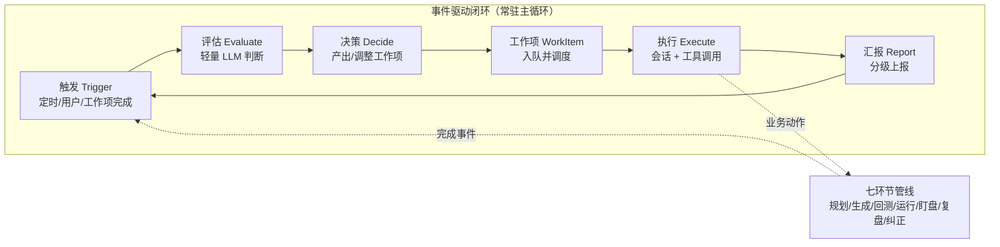
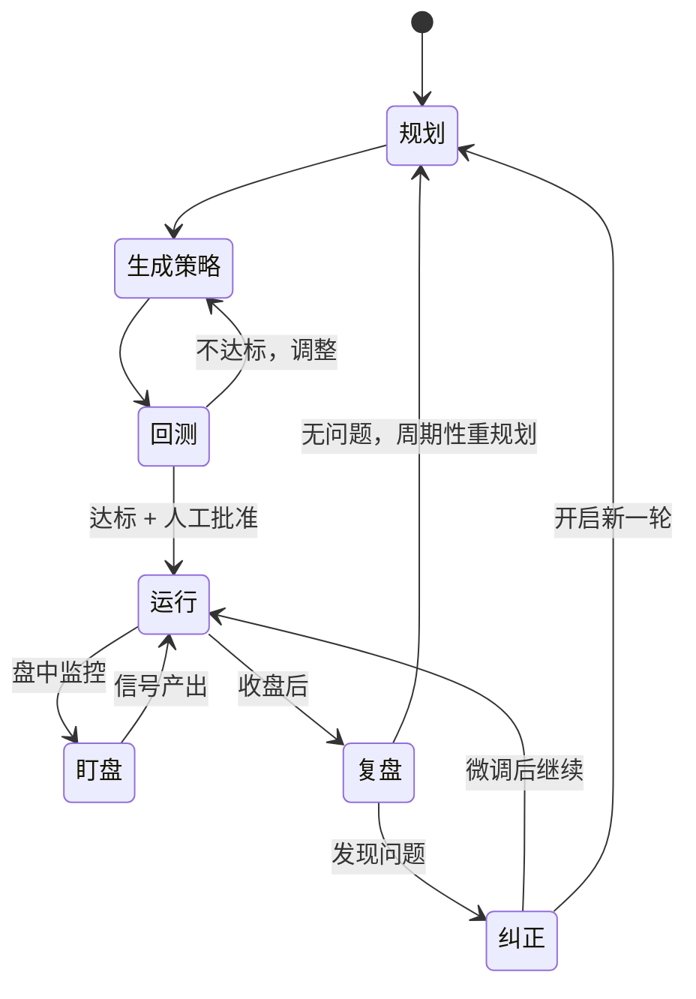

# Daydream 实现方案 · Agent 决策闭环设计

> 本文档详细设计 Daydream 的 AI 决策闭环——系统的"大脑"。参考 dsh-superagent 的事件驱动架构（「触发 → 评估 → 决策 → 工作项 → 执行 → 汇报」），结合 A 股量化决策的业务节律落地实现。
> 配套文档：[实现方案.md](./实现方案.md)（总体设计）、[实现方案-数据模型与模块设计.md](./实现方案-数据模型与模块设计.md)。

---

## 1. 设计概述

### 1.1 设计目标

1. **常驻运行**：Agent 常驻主进程，由事件驱动自主推进七环节（规划、策略生成、回测、运行、盯盘、复盘、纠正），无人干预下持续闭环。
2. **运行开关与账户无关**：启动后只要用户不点击停止就一直运行；**切换账户不中断运行**（Agent 资金视角跟随活跃账户）；应用退出时优雅停止（进程退出，无后台残留）；开关状态持久化，重启后恢复。
3. **少占用人的注意力**：只在两种情况下向用户汇报——需要人决策、或产出了可用结果；其余活动只落日志与审计，不打扰。
4. **可追溯**：每次评估、决策、执行均有持久化记录与数据快照，随时可回溯"它为什么这么做"。
5. **可接管**：任何环节均可被人工暂停、跳过、驳回或替代；自主级别可配置。
6. **对话流直达**：用户消息与 Agent 汇报（含待决策事项）统一进入首页对话流，用户可在对话流中下达指令、回答问题与响应决策。

### 1.2 运行生命周期与开关规则

| 场景 | 行为 |
| --- | --- |
| 点击「开始运行」 | 运行开关置为 ON（持久化到 `app_config` 全局行 `agent_running`）；模型未配置时拒绝启动并提示 |
| 运行中切换账户 | **不中断**：运行开关是全局状态，与账户无关；Agent 资金视角（活跃账户）随切换更新，节律事件与工作项落到新活跃账户 |
| 点击「停止运行」 | 运行开关置为 OFF（持久化）；节律事件不再触发、自动工作项不再调度；正在执行的工作项自然完成；用户对话仍可用；数据增量更新照常 |
| 关闭软件 | `before-quit` 优雅停止：停止调度与执行循环、标记内存状态 stopped；**不修改持久化开关**（重启后恢复上次运行状态，因为用户并未点击停止） |
| 重启软件 | 启动时读取持久化开关恢复运行状态（上次 ON 则自动继续运行） |

### 1.3 核心概念

| 概念 | 定义 |
| --- | --- |
| 事件（Event） | 驱动闭环的信号：定时节律、用户消息、工作项完成、预警触发、纠正完成等 |
| 评估（Evaluate） | Agent 根据事件与当前状态，判断"是否需要行动、需要什么行动"的轻量 LLM 调用 |
| 决策（Decide） | 评估结论落为行动计划：创建/调整若干工作项 |
| 工作项（WorkItem） | 持久化的任务单元，含类型、上下文、状态机、执行结果；是闭环中的最小可管理单位 |
| 执行（Execute） | 在工作项独立的 Agent 会话中，通过工具调用完成具体业务动作 |
| 汇报（Report） | 分级汇报机制，把需要人注意的事项送达首页对话流与右列待决策区块 |
| 管线（Pipeline） | 七环节的业务实现（确定性代码 + 工具），供 Agent 在工作项执行中调用 |

### 1.4 总体流程



---

## 2. 事件与触发源

### 2.1 事件定义

所有事件统一结构：`{ id, type, occurredAt, source, payload, correlationId }`，落库 `event_log` 表，保证触发链路可追溯。

所有交易节律（盘前/盘中/盘后）一律基于 **Asia/Shanghai（北京时间）** 计算，与机器本地时区无关；节假日与调休以内置交易日历为准。落库时间戳统一使用 UTC（ISO 8601），展示时转换为北京时间。

### 2.2 事件类型清单

| 类型 | 触发源 | 频率 | 说明 |
| --- | --- | --- | --- |
| `schedule.plan` | 调度器 | 每日盘前（默认 8:30） | 触发当日轻量规划评估 |
| `schedule.plan_weekly` | 调度器 | 每周五盘前（默认 8:30，替代当日轻量规划） | 触发深度规划评估 |
| `schedule.review_daily` | 调度器 | 每日盘后（默认 17:00，当日数据入库后） | 触发日复盘评估 |
| `schedule.review_weekly` | 调度器 | 每周五盘后（默认 17:30） | 触发周复盘评估 |
| ~~`schedule.monitor_tick`~~ | ~~调度器~~ | ~~盘中每 1~5 分钟~~ | **已取消**：盯盘改为定时任务直跑确定性检查（§7.5），不产生 Agent 事件，零 token 消耗 |
| `market.open` / `market.close` | 交易历 | 开盘/收盘时刻 | 运行节律基准 |
| `user.message` | 用户对话 | 按需 | 唯一的外部信息入口，用户指令/回答 |
| `workitem.completed` | 工作项 | 按需 | 上一工作项结束，驱动后续评估 |
| `alert.triggered` | 盯盘预警器 | 按需 | **仅 UI/审计事件**：预警由确定性检查产出，不进 LLM 评估（节省 token） |
| `correction.completed` | 纠正管线 | 按需 | 一轮纠正结束，开启新一轮规划 |
| `data.updated` | 数据管线 | 每交易日 | 当日数据入库完成，可触发复盘 |
| `backtest.completed` | 回测引擎 | 按需 | 回测结束，评估策略去留 |

### 2.3 事件去抖与合并

同一评估窗口内（默认 5 分钟）的同类事件合并处理，避免重复评估与并发决策；评估与决策串行执行（单队列），保证状态一致。

---

## 3. 评估（Evaluate）

### 3.1 职责

评估是**轻量**的 LLM 判断：读入事件 + 当前状态摘要（策略状态、最近信号、待决策事项、市场简报），输出结构化结论：

```jsonc
{
  "needsAction": true,          // 是否需要行动
  "reason": "……",               // 简短理由
  "suggestedActions": [         // 建议行动（可空）
    { "kind": "create_workitem", "workitemType": "backtest", "refStrategyId": "…" }
  ],
  "needsUserAttention": false,  // 是否需要引起用户注意
  "reportIfNeeded": null        // 如需汇报，见 §6 汇报对象
}
```

### 3.2 上下文组装（关键设计）

评估上下文由**摘要器**按需组装，控制 token 成本与质量：

| 上下文块 | 来源 | 说明 |
| --- | --- | --- |
| 系统身份与当前时间 | 常量 | 角色设定：量化决策助手，仅出建议 |
| 市场简报 | 数据层 | 指数涨跌、涨跌家数、量能变化（盘后含当日收盘数据） |
| 策略状态摘要 | 策略表 | 运行中/回测中/待批准/已淘汰 数量与明细摘要 |
| 最近信号摘要 | 信号表 | 近 N 条信号及人工反馈状态 |
| 持仓与账户摘要 | 账户表 | 仓位、现金、持仓盈亏（若用户维护） |
| 待决策事项 | report 表 / 工作项表 | 当前 need_decision 级汇报与 blocked（需人决策）工作项列表 |
| 最近事件 | event_log | 本次触发的关联事件链 |

### 3.3 评估质量约束

- 温度 0（或 0.1），输出经 Zod Schema 校验；
- 单次评估预算 ≤ 2k tokens 输出，超限截断并告警；
- 评估失败（LLM 不可用/校验失败）时：按事件类型的默认策略降级（例如规划/复盘事件推迟重试，其余不行动），并记录 `evaluate_fallback` 审计。

---

## 4. 决策（Decide）与工作项规划

### 4.1 职责

将评估结论落为**持久化的行动计划**：创建、更新或取消工作项。决策结果写入 `decision_record`（含评估输入快照），形成决策依据链。

### 4.2 工作项模型

| 字段 | 说明 |
| --- | --- |
| `accountId` | 所属账户（多账户隔离，见《数据模型与模块设计》§9） |
| `id` / `type` | 唯一 ID；类型见 4.3 |
| `status` | `pending → running → succeeded / failed / blocked / cancelled` |
| `priority` | 低/中/高，调度依据之一 |
| `context` | JSON：关联对象（策略 ID、回测 ID、事件 ID 等）与任务参数 |
| `sessionId` | 执行会话 ID（执行阶段创建） |
| `attempts` / `maxAttempts` | 重试计数（默认 3） |
| `scheduledAt` / `deadline` | 计划执行时间（如盘后执行）与截止时间 |
| `result` | 执行结果摘要 JSON |
| `createdAt` / `startedAt` / `finishedAt` | 时间戳 |

### 4.3 工作项类型

| 类型 | 业务含义 | 关联管线 |
| --- | --- | --- |
| `plan` | 制定阶段性行动计划 | planner |
| `generate_strategy` | 依据规划创建或迭代**账户唯一策略** DSL | strategist |
| `backtest` | 对策略执行回测验证 | backtester |
| `activate` | 策略上线评审（需人工批准） | runner |
| `monitor_review` | 盘中盯盘检查（手动/Agent 主动触发；定时盯盘已改为确定性任务直跑） | monitor |
| `review_daily` / `review_weekly` | 日/周复盘 | reviewer |
| `correct` | 执行纠正动作（改参/停用/淘汰） | corrector |
| `data_backfill` | 数据补数 | data |
| `user_request` | 用户对话引发的任务（对话流入口） | 任意管线 |

### 4.4 调度与并发

- 单工作队列 + 优先级调度，**同一业务对象串行**（如同一策略的回测与修改不并发），不同对象可并行（默认并发 2）。
- 盘中时段监控类工作项优先于研究类；研究类（生成/回测）默认安排在非交易时段（盘前/盘后）执行，避免抢占盯盘资源。
- 工作项超时（默认 30 分钟，回测可更长）自动失败并重试，重试耗尽进入 `failed` 并汇报。

---

## 5. 执行（Execute）与会话

### 5.1 会话模型

每个工作项在**独立 Agent 会话**中执行（对齐 dsh-superagent 的隔离工作会话）：

- 会话 = 消息历史 + 可调用工具集 + 上下文包（按工作项类型预组装）；
- 会话持久化于 SQLite（`agent_message` 表），崩溃后可恢复续跑；
- 会话结束（成功/失败/被人工终止）后归档，摘要写入工作项 `result`；
- **消息流直达首页**：会话全部消息（assistant text/thinking/tool_use、user tool_result、系统消息、最终 result）经桥接转发 + 归一化写入 `chat_message`（`work_item_id` 关联），首页按工作项分组折叠展示——主要结果直接可见，运行细节默认收起（见《数据模型与模块设计》§11.2）。

### 5.2 工具集

Agent 可调用的全部工具为**受控函数**（函数调用规范，JSON Schema 声明），分为五组：

| 分组 | 工具 | 说明 |
| --- | --- | --- |
| 市场数据 | `search_symbols`、`get_quote`、`get_kline`、`get_index_overview`、`get_market_breadth` | 查询行情与市场状态 |
| 策略管理 | `get_strategy`、`create_strategy`、`update_strategy`、`activate_strategy`、`deactivate_strategy` | 账户唯一策略：DSL 校验后落库；**偏好只读**；`activate` / `deactivate` 属受限操作 |
| 回测 | `run_backtest`、`get_backtest_result`、`get_backtest_trades` | 异步任务 + 轮询 |
| 账户与风控 | `get_account_summary`、`get_positions`、`check_risk` | 风控检查为只读校验 |
| 系统与汇报 | `publish_signal`、`raise_alert`、`report_to_user`、`finish_workitem` | 产出信号/预警/汇报 |

**受限操作**（默认需人工批准，见 §8）：`activate`（策略上线）、`deactivate`（停用/淘汰）、`publish_signal` 可按账户设置为"仅建议"或"需确认后推送"。

### 5.3 结构化输出与校验

关键产出（策略 DSL、行动计划、复盘结论、纠正方案）全部通过 `generateObject` + Zod Schema 强制结构化输出；解析失败自动重试 2 次，仍失败则该工作项 `failed`，不产生半成品状态。

---

## 6. 汇报（Report）与"少占用注意力"

### 6.1 汇报分级

| 级别 | 定义 | 触达方式 |
| --- | --- | --- |
| `silent` | 常规进展 | 仅审计日志，不触达 |
| `summary` | 周期摘要（如每日复盘摘要） | 首页对话流静默展示（不弹通知） |
| `result` | 可用结果（新策略回测通过、复盘报告出炉） | 首页对话流 + 系统通知（可关） |
| `need_decision` | 需要人决策（策略上线批准、纠正方案确认） | 首页对话流置顶 + 首页右列待决策区块（可就地批准/驳回）+ 系统通知 + 角标 |

### 6.2 汇报与对话流

- 全部 `summary` 及以上级别汇报除落 `report` 表外，同时写入对话流（`chat_message`，role=assistant、关联 reportId），在首页左列呈现。
- `need_decision` 汇报同时在首页右列「待决策事项」区块展示（含批准/驳回/暂缓按钮），响应结果回流闭环（`user.message` 事件）并写入对话流。

### 6.3 汇报对象

```jsonc
{
  "level": "need_decision",
  "title": "策略「动量轮动 v3」回测达标，申请上线",
  "summary": "近 3 年回测年化 18.2%，最大回撤 9.6%，样本外验证通过",
  "decision": { "kind": "activate", "strategyId": "…", "options": ["批准", "驳回", "暂缓"] },
  "artifacts": ["回测报告链接"],
  "workitemId": "…"
}
```

用户选择后通过 `user.message` 事件回流闭环，驱动对应工作项继续或终止；选择结果写入对话流。

### 6.4 防打扰原则落地

- 每日 `summary` 级别汇报合并为一次（盘后统一推送）；
- 同类 `result` 汇报在 N 小时内去重；
- 用户可配置"静默时段"与各级别通知开关；
- 一切 AI 自主活动（含被驳回的决策）均可在对话流与规划页回溯，不因"少打扰"而丢失信息。

---

## 7. 七环节业务设计

各环节以"管线实现 + Agent 工作项"组合落地：管线负责确定性的数据/计算动作，Agent 会话负责需要智能判断的部分。

### 7.1 自动规划（planner）

- **输入**：市场简报（近 N 日）、当前策略与绩效摘要、待决策事项、上一轮纠正结论。
- **产出**：结构化《阶段性行动计划》：目标（如"提升防御性，降低回撤"）、市场判断、拟研究的策略方向、优先级、时间安排。
- **落地**：计划存 `plan` 表；计划中的"生成策略"条目自动转为 `generate_strategy` 工作项。
- **节奏**：每日盘前轻量调整、每周五深度规划、每轮纠正完成后立即开启新一轮。

### 7.2 自动生成策略（strategist）

- **单例约束**：每个账户只有一份策略（策略 = 交易策略 DSL + 用户偏好，见《数据模型与模块设计》§3）。`generate_strategy` 工作项对账户已有策略做**创建（首次）或迭代（新版本）**，绝不产生第二份策略。
- **输入**：行动计划条目、市场数据（按需经工具查询）、当前策略与用户偏好（迭代时）。
- **产出**：策略 DSL 新版本（含选股域、入场/出场条件、仓位与风控参数、设计理由），修改范围由行动计划决定（局部微调或结构调整）。
- **约束**：DSL 必须通过 Schema 校验；指标引用必须在指标库白名单内；复杂度惩罚（条件数量上限）；用户偏好不可被 Agent 静默篡改（偏好只能由用户在策略页修改，Agent 仅读取）。
- **落地**：首次生成存为 `draft` 状态；迭代生成新 `strategy_version` 留档，自动创建 `backtest` 工作项。

### 7.3 自动回测（backtester）

- **输入**：策略 DSL、回测参数（区间默认近 3 年：前 2 年作样本内、最近 1 年作样本外验证，与初建数据深度一致）。
- **执行**：调用回测引擎（确定性计算，非 LLM）；结果含净值曲线、指标族、交易明细。
- **评估**：Agent 会话读回测报告，按**上/下线标准**（可配置：如年化 > 5%、最大回撤 < 15%、样本外不显著退化、最小交易次数 30）给出"通过/不通过/需调整"结论。
- **落地**：通过且满足上线条件 → 生成 `activate` 工作项（需人工批准）；不通过 → 记录结论，Agent 可决定再生成或放弃。

### 7.4 自动运行（runner）

- **职责**：运行中的策略按调度（默认每日盘后收盘价决策，次日执行）产出**交易建议（信号）**。
- **信号内容**：标的、方向（买/卖/调仓）、数量、价格参考、依据（策略逻辑与触发数据快照）、风控检查结论、有效期。
- **约束**：信号产出前必经风控引擎校验；信号仅推送，人工执行后在界面反馈"已执行/已忽略"，反馈回流用于绩效与复盘。
- **异常**：策略连续 M 次信号无法成交（如长期涨停/停牌标的）→ 触发评估，考虑换股或暂停。

### 7.5 自动盯盘（monitor）——定时任务直跑，零 token

- **执行方式**：盘中每 1~5 分钟由**调度器定时任务直接调用盯盘管线**（确定性规则检查），**不产生 Agent 事件、不经过 LLM 评估**——每轮检查零 token 消耗。
- **规则预先配置（Agent 只设置一次）**：止损/止盈阈值由 Agent 在生成/迭代策略时写入策略 DSL（`stop_loss` / `take_profit` 出场条件），盯盘任务运行时读取；涨跌停接近、指数急跌等阈值内置（后续可扩展为可配置项）。Agent 不参与每次检查。
- **范围**：持仓、自选池。
- **检查项**：涨跌停接近（按板块涨跌幅计算，距涨跌停 ≤2%）、指数急跌（当日跌幅超阈值）、持仓触及止损/止盈线（阈值来自 DSL）、信号失效（价格远离参考价）。
- **产出**：`alert` 预警（分级：提示/警告/紧急），全部**确定性产出**；提示级仅记录，警告级系统通知（不置顶），紧急级直接生成 `need_decision` 汇报（含就地响应按钮），均不进 LLM 评估。
- **资源控制**：单轮检查超时熔断；数据源故障时降级为仅指数监控并告警。

### 7.6 自动复盘（reviewer）

- **节奏**：每日盘后（轻量）+ 每周（深度）。
- **内容**：当日/当周信号与执行情况、策略表现 vs 基准（沪深 300）、市场判断回顾、问题归因（策略失效？参数退化？市场风格切换？执行偏差？）。
- **产出**：复盘报告（`review_report` 表 + 可视化数据），summary 级汇报；发现显著问题自动创建 `correct` 工作项。

### 7.7 自动纠正（corrector）

- **输入**：复盘结论中的纠正建议。
- **纠正动作谱系**（按强度递增）：参数微调（改 DSL 参数）→ 结构调整（换指标/条件）→ 暂停运行 → 停用淘汰。强度越高所需证据越强（如淘汰需：连续 N 期跑输基准 + 回撤超限）。
- **流程**：Agent 生成纠正方案 → 风控与规则校验 → 若属"微调/结构"且处于可自动范围，生成新版本 DSL 并自动回测验证，通过后替换（新版本留档，可回滚）；若属"暂停/淘汰"或涉及运行中策略，走 `need_decision` 人工确认。
- **闭环**：纠正完成发 `correction.completed` 事件 → 触发新一轮规划。

### 7.8 环节状态流转总览



---

## 8. 人工决策点与自主级别

### 8.1 默认人工决策点

| 决策点 | 默认要求 | 可配置为 |
| --- | --- | --- |
| 策略上线（activate） | 人工批准 | 自动（需勾选风险确认） |
| 策略停用/淘汰（pause/deactivate） | 人工确认 | 自动 |
| 用户偏好修改 | **仅用户操作（策略页）** | 不可关闭 |
| 紧急预警处置 | 人工 | 不可关闭 |
| 模型/数据源/账户级配置变更 | 人工（仅用户操作） | 不可关闭 |

### 8.2 自主级别（账户级配置）

| 级别 | 行为 |
| --- | --- |
| 保守（默认） | 上线/淘汰均需批准；信号均需人工确认后推送执行详情 |
| 标准 | 上线需批准；淘汰自动（证据达标）；信号自动推送 |
| 激进 | 上线/淘汰全自动；仅在异常时汇报 |

风险提示：任何级别下系统**都不执行真实交易**，级别只影响建议的产出与流转效率。

---

## 9. 状态持久化与故障恢复

| 能力 | 设计 |
| --- | --- |
| 状态落地 | 事件、评估、决策、工作项、会话、汇报全部持久化，内存仅保留运行时索引 |
| 崩溃恢复 | 启动时扫描 `running` 工作项：可安全重跑的自动重跑；会话续跑（消息历史完整）；不可重跑的标记 `failed` 并汇报 |
| 幂等 | 业务管线动作（出信号、写回测结果等）以工作项 ID 做幂等键，防止重跑重复产出 |
| 手动干预 | 任何工作项可人工暂停/取消/重试；干预动作写审计 |

## 10. 提示词工程要点

- 提示词模板版本化存储于 `src/main/agent/prompts/`，与代码同仓管理，可按版本审计实际使用的模板。
- 角色设定要点：量化决策助手、只出建议不代交易、A 股规则内行（T+1、涨跌停、交易时段）、克制且证据驱动、不确定时明确说不确定。
- 各环节提示词模板含：任务目标、可用工具说明、输出 Schema 示例、约束清单（禁忌：编造数据、编造回测结果、输出任意代码）。
- 输出一律要求"基于工具真实返回的数据"，工具结果在消息中以结构化附件注入，杜绝幻觉数据进入决策链。

## 11. 验收标准（决策闭环）

1. 安装后配置模型与数据源，系统能自主完成至少一轮「规划 → 生成/迭代策略 → 回测 →（批准后）上线」；每账户始终只有一份策略。
2. 运行策略按调度稳定产出信号，信号具备依据、数据快照与风控结论，人工可据此下单；信号展示于交易页。
3. 运行开关 ON 时切换账户不中断 Agent 运行；退出应用即停止运行且无后台残留；重启恢复上次运行状态。
4. 连续运行一周后，系统自动产出日复盘与周复盘，且复盘结论可追溯到具体数据；汇报进入首页对话流与右列待决策区块。
5. 人为构造一个持续跑输的策略，系统在约定证据条件下自动或经批准地纠正（调整/淘汰）。
6. 所有 LLM 调用、决策、工作项均有审计记录，可完整回放"系统为什么这么做"。
