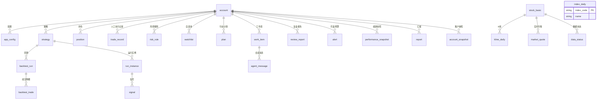

# Daydream 实现方案 · 数据模型与模块设计

> 本文档设计 Daydream 的数据模型（SQLite）与核心功能模块：行情数据、策略 DSL、回测引擎、运行与信号、盯盘、风控、绩效分析、多账户、策略安全，以及界面与 IPC 接口。
> 配套文档：[实现方案.md](./实现方案.md)（总体设计）、[实现方案-Agent决策闭环设计.md](./实现方案-Agent决策闭环设计.md)。

---

## 1. 数据库总体设计

### 1.1 基本决策

- **引擎**：SQLite + better-sqlite3（主进程独占连接，WAL 模式，`synchronous=NORMAL`）。
- **迁移**：Drizzle ORM 定义 Schema 与迁移脚本，应用启动时自动执行迁移并记录版本。
- **数据目录**：`app.getPath('userData')/data/`（macOS `~/Library/Application Support/daydream/`，Windows `%APPDATA%/daydream/`）。
- **多账户隔离**：见 §10，所有业务表含 `account_id` 外键，行情基础数据（股票列表/K 线）为全账户共享。
- **规模评估**：日线全市场约 5000 只 × 250 交易日 ≈ 125 万行/年；10 年约 1250 万行，SQLite 配合索引与行情表按年分表（统一视图）可承受。

### 1.2 表分组



### 1.3 核心表清单

| 分组 | 表 | 关键字段 | 说明 |
| --- | --- | --- | --- |
| 账户 | `account` | id, name, config_json, autonomy_level, created_at | 本地工作区，无登录 |
| 配置 | `app_config` | account_id, scope, key, value_encrypted | 模型/数据源/风控参数；密钥字段加密 |
| 行情 | `stock_basic` | code, name, exchange, industry, status | 股票基础信息（共享） |
| 行情 | `kline_daily` | code, date, open, high, low, close, volume, amount, adj_factor | 不复权原始日线（共享，唯一键 code+date） |
| 行情 | `kline_minute` | code, datetime, … | 分钟线（可选周期，仅自选/持仓池按需拉取） |
| 行情 | `market_quote` | code, price, pct_chg, volume, …, ts | 实时快照缓存 |
| 行情 | `index_daily` | index_code, date, … | 指数日线（基准与市场简报用，共享） |
| 行情 | `data_status` | code, last_update_date, integrity_level | 每标的最后更新日与完整性标记（共享） |
| 策略 | `strategy` | id, account_id, name, version, dsl_json, status, created_by, rationale | 策略本体；status 见 §3.4 |
| 策略 | `strategy_version` | id, strategy_id, dsl_json, change_log | 全版本留档，支持回滚与审计 |
| 回测 | `backtest_run` | id, strategy_version_id, params, status, metrics_json, equity_json, report_json | 回测任务与结果 |
| 回测 | `backtest_trade` | run_id, code, side, price, qty, time, pnl | 回测成交明细 |
| 运行 | `run_instance` | id, strategy_id, status, started_at, stopped_at | 策略运行实例 |
| 运行 | `signal` | id, run_id, code, side, qty, ref_price, basis_json, risk_json, status, expires_at | 交易建议；status 含人工反馈 |
| 账户 | `position` | account_id, code, qty, cost_price, updated_at | 持仓（人工维护/导入） |
| 账户 | `trade_record` | account_id, code, side, price, qty, fee, traded_at, signal_id | 人工执行记录（可关联信号） |
| 盯盘 | `watchlist` | account_id, code, note, tags | 自选/盯盘池 |
| 盯盘 | `alert` | account_id, level, type, content_json, status | 预警，level: info/warn/critical |
| 风控 | `risk_rule` | account_id, rule_key, params_json, enabled | 风控规则配置 |
| 风控 | `risk_check_result` | account_id, ref_type, ref_id, results_json, passed, checked_at | 每次风控检查留痕 |
| Agent | `plan` | account_id, period, content_json, status | 阶段性行动计划 |
| Agent | `work_item` | 见闭环设计 §4.2 | 工作项 |
| Agent | `agent_message` | session_id, role, content, tool_calls, tool_results, ts | 会话消息 |
| Agent | `decision_record` | work_item_id, event_id, input_snapshot, output_json | 决策依据快照 |
| Agent | `event_log` | account_id, type, payload, source, correlation_id, occurred_at | 事件流水 |
| 审计 | `audit_log` | actor, action, target, detail_json, ts | 全系统审计（含 LLM 调用统计） |
| 复盘 | `review_report` | account_id, period, content_json, metrics_json, created_by | 复盘报告 |
| 汇报 | `report` | account_id, level, title, summary, decision_json, status, work_item_id, artifacts_json | Agent 汇报流（含待决策事项），驱动待决策中心 |
| 绩效 | `performance_snapshot` | account_id, scope, date, metrics_json | 账户/策略绩效快照 |
| 绩效 | `account_snapshot` | account_id, date, total_assets, cash, positions_json | 每日账户净值与持仓快照（绩效计算输入） |

通用字段约定：所有业务表含 `account_id`（共享行情表除外）、`created_at`、`updated_at`；枚举值以字符串存储，由 TypeScript 联合类型约束。

---

## 2. 行情数据模块

### 2.1 数据源适配器

统一接口（主进程 `data/providers/`）：

```ts
interface MarketDataProvider {
  readonly name: string;
  getStockList(): Promise<StockBasic[]>;
  getQuote(codes: string[]): Promise<Quote[]>;
  getDailyKline(code: string, start: string, end: string): Promise<Bar[]>;
  getMinuteKline(code: string, period: '1m'|'5m'|'15m'|'30m'|'60m', start: string, end: string): Promise<Bar[]>;
  getIndexDaily(code: string, start: string, end: string): Promise<Bar[]>;
  getAdjFactors(code: string): Promise<AdjFactor[]>;
}
```

实现：`EastmoneyProvider`（首选）、`TencentProvider`（次选）、`TushareProvider`（可选付费）。管理器负责：健康检查、超时（默认 10s）、自动降级切换（**按能力路由**：次选源不具备的能力如分钟线仍由首选源提供）、限频队列（令牌桶，默认 3 次/秒）、数据完整性校验（字段范围、非空、日期连续抽查）；批量行情接口优先，减少请求次数；全部源不可用时挂起更新任务并告警（不影响已入库数据的查询与回测）。

### 2.2 入库与更新策略

- **初建**：安装后后台任务拉取全市场股票列表 + 近 3 年日线（约 5000 只 × 750 交易日，受限频影响预计 30~60 分钟完成），进度实时推送（`data.progress` 事件），可随时暂停/恢复。
- **增量**：每交易日收盘后（16:30）拉取当日全市场日线并校验入库；节假日跳过（内置交易日历，缺失时由指数数据推断）。
- **实时**：盘中按需刷新盯盘池/持仓/信号相关标的快照（`market_quote` 仅存最新值）。
- **分钟线**：仅对运行策略候选池按需拉取，默认存最近 60 个交易日，定期清理。
- **数据质量**：入库前校验（OHLC 合法性、涨跌停合理性抽查）；`data_status` 记录每标的最后更新日，Agent 查询时发现缺失自动触发补数工作项。

### 2.3 复权方案

- 原始 K 线存**不复权**数据 + 复权因子列；
- 回测引擎按需换算：前复权价 = 原价 × 因子，后复权价 = 原价 × 因子 ÷ 最新因子；
- 复权因子随日线增量更新，来源缺失时由除权日价格跳空推算（以涨跌停阈值过滤误判）并标记可信度。

---

## 3. 策略表示与执行安全（策略 DSL）

### 3.1 设计原则

- AI 生成的策略是**声明式 JSON DSL**，不是代码；由确定性解释引擎执行，无任意代码执行面（策略安全的核心）。
- DSL 由 Zod Schema 强约束，未通过校验不入库。

### 3.2 DSL 结构（示例）

```jsonc
{
  "meta": { "name": "双均线动量", "description": "…", "rationale": "…", "complexity": 2 },
  "universe": { "source": "all_a", "filters": [
    { "op": "exclude_st", "params": {} },
    { "op": "exclude_stop", "params": { "days": 1 } },
    { "op": "liquidity_min", "params": { "amount": 1e8, "days": 20 } }
  ]},
  "entry": { "logic": "and", "conditions": [
    { "indicator": "ma_cross_up", "params": { "fast": 5, "slow": 20 } },
    { "indicator": "volume_ratio_gt", "params": { "ratio": 1.5 } }
  ]},
  "exit": { "logic": "or", "conditions": [
    { "indicator": "ma_cross_down", "params": { "fast": 5, "slow": 20 } },
    { "indicator": "stop_loss", "params": { "pct": 0.08 } },
    { "indicator": "take_profit", "params": { "pct": 0.25 } },
    { "indicator": "max_holding_days", "params": { "days": 20 } }
  ]},
  "portfolio": { "max_positions": 5, "position_size": "equal_weight", "max_position_pct": 0.2, "rebalance": "daily" }
}
```

### 3.3 指标库（白名单）

解释引擎内置指标白名单，DSL 只能引用：均线类（ma/ema/ma_cross）、动量类（rsi/macd/momentum）、量价类（volume_ratio/obv）、波动类（boll/atr）、市场类（index_ma/market_breadth）、风控类（stop_loss/take_profit/max_holding_days）。新增指标走版本化发布流程；DSL 中引用未知指标 → 校验失败。

### 3.4 策略生命周期

```
draft（草稿）→ backtesting（回测中）→ pending_approval（待批准）→ active（运行中）
                                                              ↓
                              paused（暂停）←→ active；deactivated（停用/淘汰，终态）
```

每次修改产生新 `strategy_version`，运行实例绑定具体版本，回滚 = 激活旧版本。

---

## 4. 回测引擎设计

### 4.1 引擎定位

- **纯函数式确定性引擎**（`src/main/backtest/`）：输入（DSL + K 线数据 + 参数）→ 输出（净值序列 + 指标 + 交易明细），相同输入必得相同输出，是可靠性与可测试性的基石。
- **执行位置**：引擎为纯函数，回测任务在 Worker Threads / utilityProcess 中执行，主进程仅负责任务调度、进度转发与结果落库，避免 CPU 密集计算阻塞主进程事件循环与 Agent 闭环。
- 支持日线与分钟线（默认日线，分钟线对候选池可选）。
- 大量策略验证是独立任务，通过任务管理器排队执行，支持取消与进度上报。

### 4.2 A 股规则建模（正确性关键）

| 规则 | 实现 |
| --- | --- |
| T+1 | 当日买入的持仓次日方可卖出（卖出队列校验建仓日） |
| 涨跌停 | 涨跌停价按板块计算（主板 ±10%、创业板/科创板 ±20%、北交所 ±30%；主板 ST ±5%，创业板/科创板 ST 维持 ±20%）；涨停不买、跌停不卖（挂单不成交处理） |
| 最小交易单位 | 100 股整数倍，买入向下取整到整手，资金不足则按可买数量处理 |
| 交易费用 | 佣金（默认万 2.5，最低 5 元）+ 印花税（卖出 0.05%）+ 过户费（沪深双向 0.001%，2022 年 8 月后标准），参数可配 |
| 滑点 | 默认 0.1%，可配 |
| 停牌 | 无成交量的日期不可交易，持仓冻结至复牌 |
| 成交价 | 日线默认按次日开盘价成交（避免未来函数），可配置为当日收盘价/均价 |

### 4.3 输出指标族

| 类别 | 指标 |
| --- | --- |
| 收益 | 总收益率、年化收益率、月度收益分布 |
| 风险 | 最大回撤、年化波动率、夏普比率（rf 可配，默认 2%）、索提诺、卡玛 |
| 交易 | 交易次数、胜率、盈亏比、平均持仓天数、换手率 |
| 基准 | 超额收益、alpha/beta（对比沪深 300）、信息比率 |
| 样本外 | 分段（样本内/样本外）指标对比与退化检验 |

### 4.4 回测报告

每次回测产出结构化报告：指标总表、净值曲线（vs 基准）、回撤曲线、月度收益热力、成交明细、DSL 快照与数据版本号。报告数据落 `backtest_run`，渲染端可视化。

---

## 5. 运行与信号引擎

### 5.1 运行实例

- `run_instance` 绑定 `strategy_version`，状态：`active / paused / stopped`。
- 调度：默认每交易日 15:05（收盘后）跑一次决策，使用收盘后实时快照（即当日收盘价，不依赖 16:30 的日线入库任务）产出次日执行信号；可配置盘中决策（依赖分钟线）。
- 信号生成：解释引擎评估 DSL（选股域过滤 → 入场/出场条件 → 组合调整），产出目标组合与调仓清单。

### 5.2 信号（交易建议）

```jsonc
{
  "id": "sig_…", "runId": "…", "strategyId": "…",
  "code": "600519", "side": "buy", "qty": 300, "refPrice": 1712.5,
  "basis": { "triggeredCondition": "ma_cross_up(5,20)", "dataSnapshot": "…" },
  "risk": { "passed": true, "checks": [{ "rule": "position_limit", "result": "ok" }] },
  "status": "pending_execution", "expiresAt": "2026-11-04T09:30:00+08:00"
}
```

- 状态机：`pending_confirmation（保守自主级别，需人工确认）→ pending_execution → executed / ignored / expired`（人工在界面反馈）。
- 信号过期（次日开盘后未处理）自动 `expired`，并计入执行偏差指标（复盘用）。
- 信号与人工执行记录（`trade_record`）通过 `signal_id` 关联，形成"建议 → 执行 → 绩效"闭环。

---

## 6. 盯盘模块

- **盯盘池**：运行策略候选池 ∪ 持仓 ∪ 自选池，去重；盘中按 1~5 分钟轮询快照（可配）。
- **检查项**：涨跌停接近（±2% 内）、量能异动（vs 20 日均量倍数）、指数急跌（15 分钟内跌超阈值）、止损/止盈线触及、信号失效。
- **预警**：`alert` 落库 + `alert.triggered` 事件进 Agent 评估；info 级仅记录，warn 级系统通知（不置顶），critical 级走 `need_decision` 汇报。
- **资源控制**：单轮检查超时熔断；数据源故障时降级为仅指数监控并告警。

## 7. 风控模块

### 7.1 定位

所有交易建议（信号）产出前必经风控引擎校验；校验不通过的建议不推送（或降级为"风控提示"附带说明），校验过程与结果全部落 `risk_check_result`。

### 7.2 内置规则（账户级可配）

| 规则 | 默认值 |
| --- | --- |
| 单标的仓位上限 | ≤ 20% |
| 总仓位上限 | ≤ 80%（保留现金） |
| 单日新增信号数量上限 | ≤ 10 条 |
| 标的过滤 | 排除 ST/*ST、退市整理、上市不足 60 日 |
| 涨跌停防护 | 涨停不买、跌停不卖（复核信号时点行情） |
| 止损保护 | 持仓浮亏 > 8% 强制产出止损建议（提示级） |
| 极端行情熔断 | 指数当日跌幅 > 5% 时暂停新买入信号 |
| 价格偏离校验 | 信号参考价 vs 最新价偏离 > 3% 则信号标记"需人工复核" |

### 7.3 规则引擎

规则 = 声明式配置 + 确定性检查函数；检查结果结构化输出（通过/拒绝/降级 + 原因），供信号渲染与审计使用。规则配置变更需用户操作（`need_decision` 不可关闭项）。

## 8. 绩效分析模块

- **数据口径**：以 `trade_record`（人工执行记录）与每日 `account_snapshot`（账户净值 + 持仓快照，收盘后由系统自动采集或人工校正）为输入；信号与执行偏差单独统计。
- **指标**：账户级（总收益、年化、最大回撤、夏普、卡玛、胜率、盈亏比）与策略级（同上 + 换手、执行偏差率、信号命中率）。
- **归因**：收益分解（按策略/按行业/按标的）、信号-执行偏差归因（过期率、忽略率）。
- **可视化**：净值 vs 基准（沪深 300）曲线、回撤曲线、月度收益热力图、策略横向对比表；每日快照落 `performance_snapshot`，趋势页按日渲染。
- **数据入口**：用户手动录入/导入成交记录，或在信号上反馈"已执行"时自动生成 `trade_record`（含费用）。

## 9. 多账户设计

- **无登录**：`account` = 本地工作区（如"研究账户""实盘 A"），桌面端一键切换（顶栏账户切换器）。
- **隔离范围**：配置、策略、回测、信号、持仓、复盘、绩效、风控、Agent 状态均按 `account_id` 隔离；行情基础数据共享。
- **实现**：应用层数据访问统一携带当前账户上下文（仓储层注入）；主进程按账户维护独立 Agent 调度（每账户一个闭环实例，互不干扰，默认同时最多运行 1 个账户的 Agent，其余暂停，切换时切换活跃实例）。
- **敏感信息**：模型 Key 按账户独立加密存储；账户数据目录同库分区（单库多账户，避免多文件管理成本）。

## 10. 策略安全

| 层级 | 措施 |
| --- | --- |
| 存储 | 策略与全部数据仅存本地 SQLite；文件权限 0600（Windows 依赖用户目录 ACL） |
| 传输 | 策略永不主动外发；LLM 调用只发送生成所需的必要字段（不含完整策略库）；网络请求白名单校验（仅允许已配置的模型与数据源域名） |
| 加密 | 密钥（API Key）AES-256-GCM 加密存储，密钥材料经 Electron `safeStorage`（macOS Keychain / Windows DPAPI）保护；M7 评估 SQLCipher 整库加密作为可选项 |
| 执行 | DSL 白名单解释执行，无代码注入面（见 §3） |
| 导出 | 策略导出/备份为加密包，导入需校验完整性 |
| 审计 | 策略创建/修改/上线/停用全部审计留痕 |

## 11. 界面设计

### 11.1 布局

左导航（页面切换）+ 顶栏（账户切换器、Agent 状态灯、待决策角标、通知中心）+ 内容区。默认深色主题，Ant Design token 定制。

### 11.2 页面清单

| 页面 | 核心内容 |
| --- | --- |
| 仪表盘 | Agent 运行状态、今日信号、账户概览（持仓/盈亏/仓位）、待决策事项、最近预警 |
| 行情 | 股票列表（搜索/筛选）、实时行情、K 线图（lightweight-charts，前/后复权切换、均线叠加） |
| 策略中心 | 策略列表（状态/版本）、策略详情（DSL 可视化 + JSON）、生成记录与设计理由、上线/停用操作 |
| 回测 | 回测任务列表、回测报告（指标卡、净值/回撤曲线、月度热力、成交明细、样本内外对比） |
| 运行与信号 | 运行中策略、信号流（实时推送）、信号详情（依据/风控/快照）与"已执行/已忽略"反馈 |
| 盯盘 | 盯盘池、预警列表（分级）、预警规则配置 |
| 复盘 | 复盘报告列表与详情、绩效分析图表（策略对比/归因）、执行偏差统计 |
| 待决策中心 | 全部 need_decision 汇报流（批准/驳回/暂缓）、历史决策记录 |
| 审计 | 事件流水、Agent 决策记录（上下文快照）、LLM 调用统计、操作审计；支持按时间/对象筛选，回放"系统为什么这么做" |
| 设置 | 账户管理（新增/切换/删除）、模型配置、数据源配置、风控规则、Agent 自主级别、通知偏好、日志导出 |

### 11.3 汇报流与交互

- 通知中心分级展示（summary/result/need_decision），支持跳转至对应页面与对象。
- 用户对话入口（"信息入口仅通过用户对话"）：底部对话抽屉，可向 Agent 下达指令/回答问题，对话即产生 `user.message` 事件回流闭环。

## 12. IPC 接口清单（节选）

| 通道 | 方向 | 说明 |
| --- | --- | --- |
| `account:list/create/switch/delete` | 双向 | 账户管理 |
| `settings:get/update` | 双向 | 配置读写（密钥不回传） |
| `data:getKline/getQuote/getStockList` | 双向 | 行情查询（含缺失补数触发） |
| `data:onProgress` | 主→渲染 | 数据任务进度推送（也可并入 `daydream:event` 事件流） |
| `strategy:list/get/create/update/activate/deactivate` | 双向 | 策略管理（create 走 DSL 校验；activate/deactivate 按自主级别走批准流程） |
| `backtest:start/cancel/getResult/getTrades` | 双向 | 回测任务 |
| `signal:list/feedback` | 双向 | 信号查询与人工反馈 |
| `alert:list/acknowledge` | 双向 | 预警 |
| `agent:getWorkItems/retry/cancel/getPlan` | 双向 | Agent 状态与干预 |
| `daydream:event` | 主→渲染 | 统一事件流（含 report、signal.new、alert.triggered 等） |
| `perf:getSnapshot/getCharts` | 双向 | 绩效数据 |
| `review:list/getReport` | 双向 | 复盘报告 |
| `chat:send/onStream` | 双向 | 用户对话流 |

## 13. 验收标准（数据与模块）

1. 数据：初建可完整拉取全市场近 3 年日线并入库；单源故障自动降级，数据状态全程可见。
2. 回测：样例策略回测结果与手工核算一致（费用、T+1、涨跌停、复权四类规则抽查）。
3. DSL：非法 DSL（未知指标、越界参数、非白名单动作）100% 被校验拒绝，不产生半成品。
4. 信号：每条信号均含依据快照与风控结论；风控拒绝的信号不推送；人工反馈闭环可用。
5. 绩效：成交记录录入后可实时得到账户/策略指标与图表，口径可复核。
6. 多账户：账户切换后数据、策略、Agent 状态完全隔离；密钥按账户加密。
