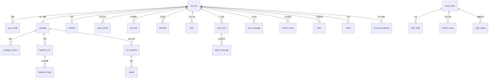

# Daydream 实现方案 · 数据模型与模块设计

> 本文档设计 Daydream 的数据模型（SQLite）与核心功能模块：行情数据、策略（含用户偏好）、回测引擎、运行与信号、交易与资金、盯盘、风控、绩效分析、多账户、策略安全，以及界面与 IPC 接口。
> 配套文档：[实现方案.md](./实现方案.md)（总体设计）、[实现方案-Agent决策闭环设计.md](./实现方案-Agent决策闭环设计.md)。

---

## 1. 数据库总体设计

### 1.1 基本决策

- **引擎**：SQLite + better-sqlite3（主进程独占连接，WAL 模式，`synchronous=NORMAL`）。
- **迁移**：版本化迁移脚本（`MIGRATIONS` 数组，按版本号顺序执行，每个版本一个事务），应用启动时自动执行并记录版本。
- **数据目录**：`app.getPath('userData')/data/`（macOS `~/Library/Application Support/daydream/`，Windows `%APPDATA%/daydream/`）。
- **多账户隔离**：见 §9，业务表按 `account_id` 隔离；行情基础数据（股票列表/K 线）为全账户共享。
- **规模评估**：日线全市场约 5000 只 × 250 交易日 ≈ 125 万行/年；10 年约 1250 万行，SQLite 配合索引与行情表按年分表（统一视图）可承受。

### 1.2 表分组



### 1.3 核心表清单

| 分组 | 表 | 关键字段 | 说明 |
| --- | --- | --- | --- |
| 账户 | `account` | id, name, **cash**, config_json, autonomy_level, created_at | 本地工作区，无登录；`cash` 为可用资金（买入/卖出联动） |
| 配置 | `app_config` | account_id, scope, key, value_encrypted | 模型配置、运行开关、主题、通知偏好；密钥字段加密 |
| 行情 | `stock_basic` | code, name, exchange, industry, status | 股票基础信息（共享） |
| 行情 | `kline_daily` | code, date, open, high, low, close, volume, amount, adj_factor | 不复权原始日线（共享，唯一键 code+date） |
| 行情 | `kline_minute` | code, datetime, period, … | 分钟线（可选周期，仅自选/持仓池按需拉取） |
| 行情 | `market_quote` | code, price, pct_chg, volume, …, ts | 实时快照缓存 |
| 行情 | `index_daily` | index_code, date, … | 指数日线（基准与市场简报用，共享） |
| 行情 | `data_status` | code, last_update_date, integrity_level | 每标的最后更新日与完整性标记（共享） |
| 策略 | `strategy` | id, account_id, name, version, dsl_json, **preferences_json**, status, created_by, rationale | **每账户唯一一份**（UNIQUE account_id）；= 交易策略 + 用户偏好 |
| 策略 | `strategy_version` | id, strategy_id, version, dsl_json, change_log | 全版本留档，支持回滚与审计 |
| 回测 | `backtest_run` | id, strategy_version_id, params, status, metrics_json, equity_json, report_json | 回测任务与结果 |
| 回测 | `backtest_trade` | run_id, code, side, price, qty, time, pnl | 回测成交明细 |
| 运行 | `run_instance` | id, strategy_id, status, started_at, stopped_at | 策略运行实例 |
| 运行 | `signal` | id, run_id, code, side, qty, ref_price, basis_json, risk_json, status, expires_at | 交易建议；status 含人工反馈 |
| 账户 | `position` | account_id, code, qty, cost_price, updated_at | 持仓（买入/卖出联动 + 人工维护） |
| 账户 | `trade_record` | account_id, code, side, price, qty, fee, traded_at, signal_id, note | 成交记录（买入/卖出/信号执行生成） |
| 对话 | `chat_message` | id, account_id, role, content, **kind, meta_json, work_item_id, session_id**, report_id, created_at | 首页对话流持久化；kind 适配 Claude Code 全部消息格式（text/thinking/tool_use/tool_result/system/result/error/report），运行细节按工作项分组折叠 |
| 盯盘 | `watchlist` | account_id, code, note, tags | 自选/盯盘池 |
| 盯盘 | `alert` | account_id, level, type, content_json, status | 预警，level: info/warn/critical |
| 风控 | `risk_rule` | account_id, rule_key, params_json, enabled | 风控规则配置 |
| 风控 | `risk_check_result` | account_id, ref_type, ref_id, results_json, passed, checked_at | 每次风控检查留痕 |
| Agent | `plan` | account_id, period, content_json, status | 阶段性行动计划 |
| Agent | `work_item` | 见闭环设计 §4.2 | 工作项 |
| Agent | `agent_message` | session_id, role, content, tool_calls, tool_results, ts | 工作项会话消息 |
| Agent | `decision_record` | work_item_id, event_id, input_snapshot, output_json | 决策依据快照 |
| Agent | `event_log` | account_id, type, payload, source, correlation_id, occurred_at | 事件流水 |
| 审计 | `audit_log` | actor, action, target, detail_json, ts | 全系统审计（含 LLM 调用统计） |
| 复盘 | `review_report` | account_id, period, content_json, metrics_json, created_by | 复盘报告 |
| 汇报 | `report` | account_id, level, title, summary, decision_json, status, work_item_id, artifacts_json | Agent 汇报流（驱动首页对话流与右列待决策区块） |
| 绩效 | `performance_snapshot` | account_id, scope, date, metrics_json | 账户/策略绩效快照 |
| 绩效 | `account_snapshot` | account_id, date, total_assets, cash, positions_json | 每日账户净值与持仓快照（绩效计算输入） |

通用字段约定：业务表含 `account_id`（共享行情表除外）、`created_at`、`updated_at`；枚举值以字符串存储，由 TypeScript 联合类型约束。

### 1.4 本次重构的迁移变更（v2）

| 变更 | 说明 |
| --- | --- |
| `strategy` 表加 UNIQUE 约束 | `CREATE UNIQUE INDEX idx_strategy_account ON strategy(account_id)`，每账户唯一一份策略；存量数据每账户保留最新一份，其余删除（其历史版本仍保留于 `strategy_version`） |
| `strategy` 表新增 `preferences_json` | 用户偏好（风险偏好、投资风格、仓位限制、自主级别、通知偏好等），与交易策略 DSL 并存；存量行回填默认偏好 |
| `account` 表新增 `cash` | 可用资金（默认 100000），买入/卖出联动 |
| 新增 `chat_message` 表 | 首页对话流持久化 |
| `app_config` 新增全局键 | `agent_running`（运行开关）、`theme`（light/dark/system）、`run_mode`（manual/auto 运行模式）、`notify_prefs`（通知偏好） |
| 账户创建副作用扩展 | 新账户除播种风控规则外，自动创建一份**默认策略**（draft：默认偏好 + 空 DSL 模板） |
| v3：`chat_message` 扩展 | 新增 `kind`（Claude 消息类型）、`meta_json`（工具名/入参/耗时等）、`work_item_id`、`session_id` 列 + 索引；支撑全部 Agent 消息进对话流与运行细节折叠 |

---

## 2. 行情数据模块

### 2.1 数据源适配器

统一接口（主进程 `data/providers/`）：

```ts
interface MarketDataProvider {
  readonly name: string;
  getStockList(): Promise<StockBasic[]>;
  getQuote(codes: string[]): Promise<Quote[]>;
  getDailyKline(code: string, start: string, end: string): Promise<Bar[]>;
  getMinuteKline(code: string, period: '1m'|'5m'|'15m'|'30m'|'60m', start: string, end: string): Promise<Bar[]>;
  getIndexDaily(code: string, start: string, end: string): Promise<Bar[]>;
  getAdjFactors(code: string): Promise<AdjFactor[]>;
}
```

实现：`EastmoneyProvider`（首选）、`TencentProvider`（次选）、`TushareProvider`（可选付费）。管理器负责：健康检查、超时（默认 10s）、自动降级切换（**按能力路由**：次选源不具备的能力如分钟线仍由首选源提供）、限频队列（令牌桶，默认 3 次/秒）、数据完整性校验（字段范围、非空、日期连续抽查）；批量行情接口优先，减少请求次数；全部源不可用时挂起更新任务并告警（不影响已入库数据的查询与回测）。

### 2.2 入库与更新策略

- **一键同步（全量初始化）**：数据页触发，拉取全市场股票列表 + 近 N 年日线（N 默认 3，可配置），进度实时推送（`data.progress` 事件），可随时暂停/恢复；**Agent 运行时同样可触发与操作（不互斥）**。
- **一键同步（每日增量）**：拉取当日全市场日线并校验入库；每交易日收盘后（16:30）调度器自动触发一次。
- **实时**：盘中按需刷新盯盘池/持仓/信号相关标的快照（`market_quote` 仅存最新值）。
- **分钟线**：仅对运行策略候选池按需拉取，默认存最近 60 个交易日，定期清理。
- **数据质量**：入库前校验（OHLC 合法性、涨跌停合理性抽查）；`data_status` 记录每标的最后更新日，Agent 查询时发现缺失自动触发补数工作项。

### 2.3 数据增删改查（CRUD）

数据页支持人工维护，与 Agent 运行互不锁定：

| 操作 | 说明 |
| --- | --- |
| 股票新增/修改/删除 | `stock_basic` upsert/delete；删除股票级联删除其 K 线与数据状态 |
| K 线新增/修改/删除 | `kline_daily` upsert/delete（按 code+date 唯一键）；用于补录、纠错、删脏数据 |
| 数据状态维护 | 修改 `data_status` 完整性标记（可选） |

所有 CRUD 操作写审计日志；删除为受限操作（需确认）。

### 2.4 复权方案

- 原始 K 线存**不复权**数据 + 复权因子列；
- 回测引擎按需换算：前复权价 = 原价 × 因子，后复权价 = 原价 × 因子 ÷ 最新因子；
- 复权因子随日线增量更新，来源缺失时由除权日价格跳空推算（以涨跌停阈值过滤误判）并标记可信度。

---

## 3. 策略表示（策略 DSL + 用户偏好）

### 3.1 设计原则

- **每账户唯一一份策略**：策略 = 交易策略（声明式 JSON DSL）+ 用户偏好（preferences JSON），二者共存于 `strategy` 行。
- AI 生成的交易策略是**声明式 JSON DSL**，不是代码；由确定性解释引擎执行，无任意代码执行面（策略安全的核心）。
- DSL 由 Zod Schema 强约束，未通过校验不入库；用户偏好由 Schema 约束，仅用户可修改（Agent 只读）。

### 3.2 交易策略 DSL 结构（示例）

```jsonc
{
  "meta": { "name": "双均线动量", "description": "…", "rationale": "…", "complexity": 2 },
  "universe": { "source": "all_a", "filters": [
    { "op": "exclude_st", "params": {} },
    { "op": "exclude_stop", "params": { "days": 1 } },
    { "op": "liquidity_min", "params": { "amount": 1e8, "days": 20 } }
  ]},
  "entry": { "logic": "and", "conditions": [
    { "indicator": "ma_cross_up", "params": { "fast": 5, "slow": 20 } },
    { "indicator": "volume_ratio_gt", "params": { "ratio": 1.5 } }
  ]},
  "exit": { "logic": "or", "conditions": [
    { "indicator": "ma_cross_down", "params": { "fast": 5, "slow": 20 } },
    { "indicator": "stop_loss", "params": { "pct": 0.08 } },
    { "indicator": "take_profit", "params": { "pct": 0.25 } },
    { "indicator": "max_holding_days", "params": { "days": 20 } }
  ]},
  "portfolio": { "max_positions": 5, "position_size": "equal_weight", "max_position_pct": 0.2, "rebalance": "daily" }
}
```

### 3.3 指标库（白名单）

解释引擎内置指标白名单，DSL 只能引用：均线类（ma/ema/ma_cross）、动量类（rsi/macd/momentum）、量价类（volume_ratio/obv）、波动类（boll/atr）、市场类（index_ma/market_breadth）、风控类（stop_loss/take_profit/max_holding_days）。新增指标走版本化发布流程；DSL 中引用未知指标 → 校验失败。

### 3.4 用户偏好（preferences）

```jsonc
{
  "riskTolerance": "moderate",            // 风险偏好：conservative 保守 / moderate 稳健 / aggressive 激进
  "investmentStyle": "trend",             // 投资风格：value 价值 / growth 成长 / trend 趋势 / blend 均衡
  "expectedAnnualReturn": 0.15,           // 期望年化收益（参考值）
  "maxDrawdownTolerance": 0.15,           // 最大可承受回撤
  "holdingPeriod": "swing",               // 持股周期：short 短线（≤5 日）/ swing 波段（≤20 日）/ long 中长线（>20 日）
  "preferredIndustries": ["白酒", "新能源"], // 偏好行业（可空）
  "excludedIndustries": [],               // 排除行业（可空）
  "maxPositions": 5,                      // 最大持仓数量
  "maxPositionPct": 0.2,                  // 单票仓位上限
  "maxTotalPositionPct": 0.8,             // 总仓位上限
  "tradeFrequency": "medium",             // 交易频率偏好：low 低频 / medium 中频 / high 高频
  "autonomyLevel": "conservative",        // 自主级别：conservative / standard / aggressive
  "notify": { "signals": true, "alerts": true, "summaries": true, "quietHours": "22:00-08:00" }
}
```

**偏好与 DSL 的关系**：偏好在策略执行与风控中生效（仓位限制、自主级别、通知偏好直接参与信号产出与汇报），Agent 生成/迭代策略 DSL 时读取偏好作为约束（如持仓数量、仓位上限不得违反偏好）。

**自主级别唯一事实来源**：`autonomyLevel` 以 `preferences` 为准；`account.autonomy_level` 列为兼容保留字段（保存偏好时同步，不再作为决策依据）。

### 3.5 策略生命周期

```
draft（草稿）→ backtesting（回测中）→ pending_approval（待批准）→ active（运行中）
                                                              ↓
                              paused（暂停）←→ active；deactivated（停用/淘汰，终态）
```

每次修改产生新 `strategy_version`，运行实例绑定具体版本，回滚 = 激活旧版本。用户偏好修改不产生策略版本（偏好与 DSL 分列存储，偏好修改即时生效）。

---

## 4. 回测引擎设计

### 4.1 引擎定位

- **纯函数式确定性引擎**（`src/main/backtest/`）：输入（DSL + K 线数据 + 参数）→ 输出（净值序列 + 指标 + 交易明细），相同输入必得相同输出，是可靠性与可测试性的基石。
- **执行位置**：引擎为纯函数，回测任务在 Worker Threads / utilityProcess 中执行，主进程仅负责任务调度、进度转发与结果落库，避免 CPU 密集计算阻塞主进程事件循环与 Agent 闭环。
- 支持日线与分钟线（默认日线，分钟线对候选池可选）。
- 回测为 Agent 内部能力（策略生成/修改后自动回测）；UI 上回测摘要展示于策略页。

### 4.2 A 股规则建模（正确性关键）

| 规则 | 实现 |
| --- | --- |
| T+1 | 当日买入的持仓次日方可卖出（卖出队列校验建仓日） |
| 涨跌停 | 涨跌停价按板块计算（主板 ±10%、创业板/科创板 ±20%、北交所 ±30%；主板 ST ±5%，创业板/科创板 ST 维持 ±20%）；涨停不买、跌停不卖（挂单不成交处理） |
| 最小交易单位 | 100 股整数倍，买入向下取整到整手，资金不足则按可买数量处理 |
| 交易费用 | 佣金（默认万 2.5，最低 5 元）+ 印花税（卖出 0.05%）+ 过户费（沪深双向 0.001%，2022 年 8 月后标准），参数可配 |
| 滑点 | 默认 0.1%，可配 |
| 停牌 | 无成交量的日期不可交易，持仓冻结至复牌 |
| 成交价 | 日线默认按次日开盘价成交（避免未来函数），可配置为当日收盘价/均价 |

### 4.3 输出指标族

| 类别 | 指标 |
| --- | --- |
| 收益 | 总收益率、年化收益率、月度收益分布 |
| 风险 | 最大回撤、年化波动率、夏普比率（rf 可配，默认 2%）、索提诺、卡玛 |
| 交易 | 交易次数、胜率、盈亏比、平均持仓天数、换手率 |
| 基准 | 超额收益、alpha/beta（对比沪深 300）、信息比率 |
| 样本外 | 分段（样本内/样本外）指标对比与退化检验 |

### 4.4 回测报告

每次回测产出结构化报告：指标总表、净值曲线（vs 基准）、回撤曲线、月度收益热力、成交明细、DSL 快照与数据版本号。报告数据落 `backtest_run`；策略页展示最近一次回测摘要。

---

## 5. 运行与信号引擎

### 5.1 运行实例

- `run_instance` 绑定 `strategy_version`，状态：`active / paused / stopped`。
- 调度：默认每交易日 15:05（收盘后）跑一次决策，使用收盘后实时快照（即当日收盘价，不依赖 16:30 的日线入库任务）产出次日执行信号；可配置盘中决策（依赖分钟线）。
- 信号生成：解释引擎评估 DSL（选股域过滤 → 入场/出场条件 → 组合调整），产出目标组合与调仓清单。

### 5.2 信号（交易建议）

```jsonc
{
  "id": "sig_…", "runId": "…", "strategyId": "…",
  "code": "600519", "side": "buy", "qty": 300, "refPrice": 1712.5,
  "basis": { "triggeredCondition": "ma_cross_up(5,20)", "dataSnapshot": "…" },
  "risk": { "passed": true, "checks": [{ "rule": "position_limit", "result": "ok" }] },
  "status": "pending_execution", "expiresAt": "2026-11-04T09:30:00+08:00"
}
```

- 状态机：`pending_confirmation（保守自主级别，需人工确认）→ pending_execution → executed / ignored / expired`（人工在交易页反馈）。
- 信号过期（次日开盘后未处理）自动 `expired`，并计入执行偏差指标（复盘用）。
- 信号与人工执行记录（`trade_record`）通过 `signal_id` 关联，形成"建议 → 执行 → 绩效"闭环；反馈"已执行"时自动生成成交记录并联动资金/持仓（见 §6）。

---

## 6. 交易与资金模块（交易页）

> 核心原则：系统不接入券商通道，买入/卖出为**应用内录入**（记录人工在券商侧的真实成交），录入联动可用资金与持仓，保证资金统计口径正确。

### 6.1 资金模型

- `account.cash`：可用资金（初始默认 100,000，设置页可改）。
- **买入**：`cash -= 金额 + 费用`；`position.qty += qty`，成本价加权平均。
- **卖出**：`cash += 金额 - 费用`；`position.qty -= qty`（清仓删除持仓行）；卖出收益计入盈亏。
- 每次买入/卖出生成 `trade_record`；操作在一个事务内完成（现金、持仓、成交记录一致）。
- 信号反馈「已执行」= 自动走一遍买入/卖出联动（价格/数量取人工填写的实际成交值）。

### 6.2 资金统计（概览）

| 指标 | 口径 |
| --- | --- |
| 总资产 | `cash + Σ(持仓 qty × 现价)`（现价取 `market_quote`，无行情时取成本价） |
| 可用资金 | `account.cash` |
| 持仓市值 | `Σ(持仓 qty × 现价)` |
| 持仓盈亏 | `Σ(qty × (现价 - 成本价))` |
| 总盈亏 | 总资产 - 初始资金（`initial_cash` 记录于账户 config） |
| 当日盈亏 | 与最近 `account_snapshot` 对比 |
| 资金曲线 | `account_snapshot` 每日净值序列（ECharts 折线） |

### 6.3 交易页功能清单

| 区块 | 内容 |
| --- | --- |
| 概览（资金统计） | 总资产/可用资金/持仓市值/持仓盈亏/总盈亏/当日盈亏 + 资金曲线 |
| 买入 / 卖出 | 表单：股票（搜索）、价格、数量（手）、预估费用 → 确认后联动资金与持仓；卖出需校验持仓数量 |
| 持仓管理 | 持仓列表（现价、市值、盈亏、仓位占比、成本价），人工增删改（录入真实持仓/纠正） |
| 仓位管理 | 总仓位、各持仓仓位占比（分布图）、与策略偏好目标仓位（maxPositionPct/maxTotalPositionPct）对比提示 |
| 交易建议（信号） | 信号列表（依据/风控结论/有效期），反馈「已执行」（填实际成交价/量）或「已忽略」 |
| 成交记录 | 买入/卖出流水（含费用、关联信号），筛选与统计 |
| 预警 | 盯盘预警列表（info/warn/critical），确认关闭 |

---

## 7. 盯盘模块（定时任务直跑，零 token 消耗）

- **执行方式**：盘中每 1~5 分钟由调度器**定时任务直接调用**盯盘管线（确定性规则检查），不经过 LLM 评估；Agent 只负责**预先配置规则**（止损/止盈阈值写入策略 DSL 出场条件，生成/迭代策略时一次性完成）。
- **盯盘池**：持仓 ∪ 自选池，去重；盘中按 1~5 分钟轮询快照（可配）。
- **检查项**：涨跌停接近（按板块涨跌幅计算，距涨跌停 ≤2%）、指数急跌（当日跌幅超阈值）、止损/止盈线触及（阈值来自策略 DSL）、信号失效（价格远离参考价 >3%）。
- **预警**：`alert` 落库 + `alert.triggered` 事件推送 UI（**不进 LLM 评估**）；info 级仅记录，warn 级系统通知（不置顶），critical 级直接生成 `need_decision` 汇报（确定性产出，含就地响应按钮，同步写入首页对话流）。预警列表展示于交易页。
- **资源控制**：单轮检查超时熔断；数据源故障时降级为仅指数监控并告警。

## 8. 风控模块

### 8.1 定位

所有交易建议（信号）产出前必经风控引擎校验；校验不通过的建议不推送（或降级为"风控提示"附带说明），校验过程与结果全部落 `risk_check_result`。

### 8.2 内置规则（账户级可配）

| 规则 | 默认值 |
| --- | --- |
| 单标的仓位上限 | ≤ 20%（与偏好 maxPositionPct 联动） |
| 总仓位上限 | ≤ 80%（与偏好 maxTotalPositionPct 联动，保留现金） |
| 单日新增信号数量上限 | ≤ 10 条 |
| 标的过滤 | 排除 ST/*ST、退市整理、上市不足 60 日 |
| 涨跌停防护 | 涨停不买、跌停不卖（复核信号时点行情） |
| 止损保护 | 持仓浮亏 > 8% 强制产出止损建议（提示级） |
| 极端行情熔断 | 指数当日跌幅 > 5% 时暂停新买入信号 |
| 价格偏离校验 | 信号参考价 vs 最新价偏离 > 3% 则信号标记"需人工复核" |

### 8.3 规则引擎

规则 = 声明式配置 + 确定性检查函数；检查结果结构化输出（通过/拒绝/降级 + 原因），供信号渲染与审计使用。规则配置变更需用户操作（`need_decision` 不可关闭项）。

## 9. 绩效分析模块

- **数据口径**：以 `trade_record`（成交记录）与每日 `account_snapshot`（账户净值 + 持仓快照，收盘后由系统自动采集或人工校正）为输入；信号与执行偏差单独统计。
- **指标**：账户级（总收益、年化、最大回撤、夏普、卡玛、胜率、盈亏比）与策略级（同上 + 换手、执行偏差率、信号命中率）。
- **可视化**：资金曲线、盈亏分布；每日快照落 `performance_snapshot`。绩效摘要展示于首页右列与交易页概览（资金曲线）。

## 10. 多账户设计

- **无登录**：`account` = 本地工作区（如"研究账户""实盘 A"），桌面端 header 账户下拉切换 + 添加账户按钮。
- **隔离范围**：配置、**唯一策略（含偏好）**、回测、信号、持仓、资金、成交记录、复盘、绩效、风控、对话流、汇报、预警均按 `account_id` 隔离；行情基础数据共享。
- **实现**：应用层数据访问统一携带当前账户上下文（仓储层注入）；主进程维护**全局唯一 Agent 闭环实例**，运行开关全局；活跃账户（`activeAccountId`）即 Agent 资金视角，切换账户不中断 Agent 运行（运行开关与账户解耦）。
- **敏感信息**：模型 Key 全局加密存储；账户数据同库分区（单库多账户，避免多文件管理成本）。

## 11. 界面设计

### 11.1 布局框架

header（48px 自绘标题栏）+ sider（自研导航，可收起）+ content。详见《实现方案》§6。主题：light / dark / system（默认 dark），antd ConfigProvider + CSS 变量。

### 11.2 首页（home）

- **左列（对话流，flex 3）**：
  - @ant-design/x：`Bubble` 消息流 + `Sender` 输入框；消息持久化于 `chat_message`（重启可回看）。
  - **适配 Claude Code 全部消息格式**：桥接子进程把 claude-agent-sdk 的完整消息流转发主进程，经归一化写入对话流：
    | Claude 消息/内容块 | 对话流 kind | 展示方式 |
    | --- | --- | --- |
    | assistant 内容块：`text` | `assistant_text` | 运行细节（折叠） |
    | assistant 内容块：`thinking` | `thinking` | 运行细节（折叠） |
    | assistant 内容块：`tool_use`（含入参） | `tool_use` | 运行细节（折叠，显示工具名+入参） |
    | user 内容块：`tool_result` | `tool_result` | 运行细节（折叠，截断存储） |
    | `tool_progress` / `tool_use_summary` | 同左 | 运行细节（折叠） |
    | `system`（权限/提示等；init/session_ready 等噪声丢弃） | `system` | 运行细节（折叠） |
    | `result`（success） | `result` | **主要结果** |
    | `result`（error 子类型） | `error` | **主要结果（错误）** |
    | `stream_event`（增量流）/`thinking_tokens` 等高频噪声 | — | 丢弃 |
  - **折叠浏览**：运行细节按工作项（`work_item_id`）归组到其前最近的主要结果下，默认收起（「运行细节（N）」可展开）；主要结果（最终文本/工作项完成/汇报/错误）直接展示。
  - **消息展示信息**：每条消息展示头像（用户/Agent 区分配色）、角色标签（用户 / Agent / Agent 汇报）、时间戳（MM-DD HH:mm）、来源标签（工作项类型/调用目的）与类型标签（结果/错误/汇报）；运行细节行同样带类型标签与时间。
  - **分页与性能**：游标分页（`createdAt + rowid`）——首次加载最新一页（默认 100 条），向上滚动接近顶部自动加载更早一页并保持视口位置；新消息经 `after` 游标增量拉取（按 id 去重），用户接近底部时自动滚底；顶部展示加载指示与「已到最早消息」。
  - 消息类型：用户消息、Agent 全部输出（用户请求会话、工作项执行的全部 LLM 消息、工具调用与结果、思考、系统消息）、Agent 汇报（result/summary/need_decision，可内联响应按钮）。
  - 输入即 `chat:send` → `user_request` 工作项 → Agent 会话全部消息经消息流实时进入对话流。
- **右列（统计与重要内容，flex 2）**：
  - 区块：Agent 状态（运行开关/最近心跳）、账户概览（总资产/盈亏）、最近信号、待决策事项（批准/驳回/暂缓）、数据状态、最近预警。
  - **不用卡片组件**：各区块以**虚线**（`border-bottom: 1px dashed`）分隔；**左右两列之间实线**（`border-left: 1px solid`）分隔。
- 待决策响应后回流闭环（`report:respond`）。

### 11.3 交易（trade）

Tabs：概览（资金统计）/ 买入卖出 / 持仓管理 / 仓位管理 / 交易建议 / 成交记录 / 预警。内容见 §6.3。

### 11.4 策略（strategy）

- **单策略视图**：顶部为策略状态（生命周期）与名称；主体分两栏：
  - **用户偏好**（表单化编辑：风险偏好、投资风格、期望收益、回撤容忍、持股周期、偏好/排除行业、仓位限制、自主级别、通知偏好）。
  - **交易策略 DSL**（可视化编辑）：
    - 选股域（过滤条件可视化块：ST 过滤/流动性过滤等，可增删排序）；
    - 入场/出场条件（条件块可视化：指标 + 参数 + and/or 逻辑）；
    - 组合配置（持仓数/仓位/再平衡）；
    - **高级 JSON 编辑**（校验失败提示，通过后回填可视化）。
  - 浏览模式：条件结构树/流程图 + 指标卡片摘要。
- **版本历史**：时间线列出 `strategy_version`（DSL 快照、变更说明、回滚）。
- **回测摘要**：最近一次 `backtest_run` 指标（年化/回撤/胜率等）+ 状态。
- 操作：保存（生成新版本）、激活/停用（走批准流程）。

### 11.5 规划（plan）

- **执行节律时间轴**（可视化 Agent loop 执行时间点与内容）：盘前 8:30 规划（周五深度）→ 盘中盯盘（每 N 分钟）→ 15:05 运行决策 → 16:30 数据增量 → 17:00 日复盘（周五 17:30 周复盘），标注是否交易日与今日状态（已执行/待执行）。
- **闭环流程**：触发 → 评估 → 决策 → 工作项 → 执行 → 汇报 步骤条（Steps）+ 最近一次各环节耗时/状态。
- **当前行动计划**：`plan` 表最新内容（目标、市场判断、研究方向、优先级）。
- **工作项队列**：表格（类型、状态、优先级、计划时间、关联对象），支持重试/取消。
- **最近事件**：`event_log` 流水（类型、时间、来源）。

### 11.6 数据（data）

- **股票列表**：搜索/筛选（板块/状态），分页虚拟滚动；行内查看 K 线（lightweight-charts，前/后复权切换、均线叠加）。
- **指数数据**：主要指数日线列表与图表。
- **同步**：「全量初始化同步」「每日增量更新」按钮 + 进度条（`data.progress` 事件）；数据源状态与免责声明。
- **CRUD**：新增/编辑/删除股票；K 线数据表格化增删改（按 code 过滤、按日期区间）；删除需确认。Agent 运行时可用。
- **数据统计**：股票数、K 线行数、日期范围、最近更新时间。

### 11.7 设置（settings）

- **账户信息**：账户名称修改、删除账户（需确认）。
- **模型信息**：内置预设下拉（DeepSeek / OpenAI / Anthropic / Moonshot / 通义千问 / 智谱 / 硅基流动，选择后自动填充 baseURL、模型名、重型模型名、上下文长度、频率上限）；API Key 输入（加密存储，不回显明文）；自定义 baseURL 模式；连接测试。
- **主题**：亮色 / 暗色 / 系统（与 header 主题按钮同步）。
- **通知偏好**：信号/预警/摘要通知开关、静默时段。
- **数据源**：数据源偏好（东财/腾讯/自动）、初始化年份数 N。
- **日志导出**：导出日志包。

## 12. IPC 接口清单

| 通道 | 方向 | 说明 |
| --- | --- | --- |
| `account:list/create/switch/delete/rename` | 双向 | 账户管理（create 自动播种风控规则 + 默认策略） |
| `settings:get/update` | 双向 | 配置读写（密钥不回传；模型预设列表内置返回） |
| `theme:get/set` | 双向 | 主题（light/dark/system），主进程同步 nativeTheme |
| `runMode:get/set` | 双向 | 运行模式（manual 手动 / auto 自动：自动处理审批与信号，策略验证用）；切换广播 `runMode.changed` |
| `window:minimize/toggleMaximize/close` | 渲染→主 | 自绘标题栏窗口控制（Windows） |
| `data:getKline/getQuote/getStockList/getIndexDaily/getDataStatus/getDataStats` | 双向 | 行情查询 |
| `data:initialSync/dailyUpdate` | 双向 | 一键同步（全量/增量），进度走 `data.progress` |
| `data:upsertStock/deleteStock/upsertKline/deleteKline` | 双向 | 数据 CRUD（Agent 运行时可用） |
| `strategy:getForAccount/save` | 双向 | 每账户唯一策略：读取（含偏好）/保存（DSL 校验 + 新版本；偏好仅用户可改） |
| `strategy:getVersions/rollback` | 双向 | 版本历史与回滚 |
| `strategy:activate/pause/deactivate` | 双向 | 生命周期操作（按自主级别走批准流程） |
| `strategy:getLatestBacktest` | 双向 | 最近回测摘要（策略页展示） |
| `trade:buy/sell` | 双向 | 人工买入/卖出录入（事务联动资金/持仓/成交记录） |
| `trade:list` | 双向 | 成交记录 |
| `trade:accountSummary` | 双向 | 资金统计（总资产/盈亏/仓位分布/资金曲线） |
| `position:list/upsert` | 双向 | 持仓管理 |
| `signal:list/feedback` | 双向 | 信号查询与人工反馈（feedback=executed 自动联动资金/持仓） |
| `alert:list/acknowledge` | 双向 | 预警 |
| `chat:send/list` | 双向 | 对话流：发送（用户消息落库 + user_request 工作项）/历史消息 |
| `report:list/respond` | 双向 | 待决策事项（首页右列） |
| `agent:getWorkItems/retry/cancel/getPlan/getStatus/start/stop` | 双向 | Agent 状态与干预（start 校验模型配置；运行开关全局） |
| `daydream:event` | 主→渲染 | 统一事件流（chat.message、report、signal.new、alert.triggered、data.progress、workitem.updated 等） |

## 13. 验收标准（数据与模块）

1. 数据：一键全量同步可完整拉取全市场近 3 年日线并入库；增量更新可用；单源故障自动降级，数据状态全程可见；CRUD 在 Agent 运行时可用且不损坏一致性。
2. 回测：样例策略回测结果与手工核算一致（费用、T+1、涨跌停、复权四类规则抽查）。
3. DSL：非法 DSL（未知指标、越界参数、非白名单动作）100% 被校验拒绝，不产生半成品；偏好 Schema 校验非法偏好被拒绝。
4. 资金：买入/卖出事务联动正确（现金、持仓、成交记录三方一致）；资金统计口径可复核。
5. 策略：每账户始终只有一份策略；偏好修改即时生效且不产生策略版本；版本历史可回滚。
6. 信号：每条信号均含依据快照与风控结论；风控拒绝的信号不推送；人工反馈闭环可用（已执行自动联动资金）。
7. 多账户：账户切换后策略、资金、持仓、对话流、汇报完全隔离；Agent 运行不中断；密钥按全局加密。
8. 对话流：消息持久化，重启可回看；Agent 汇报（含待决策）进入对话流与右列待决策区块。
