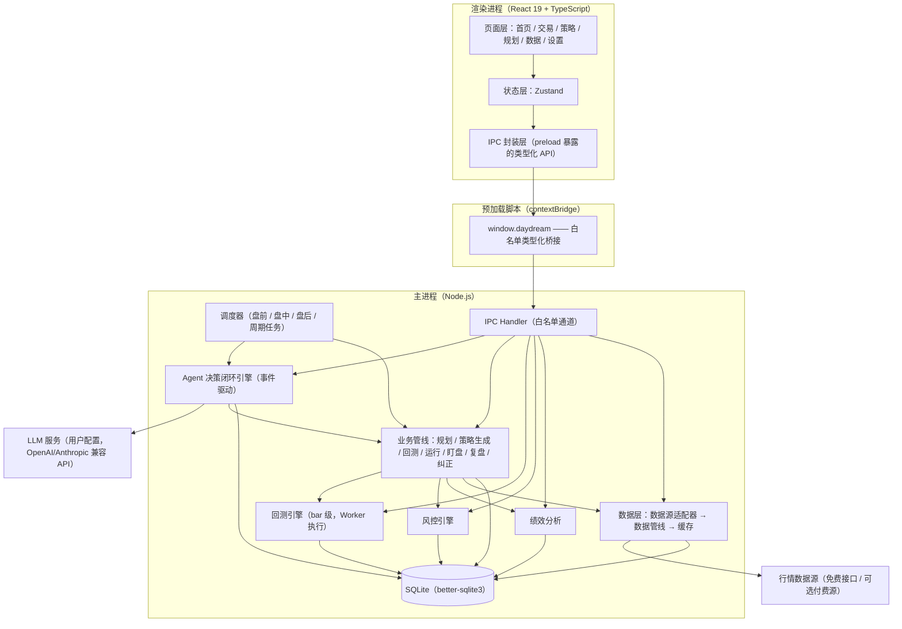

# Daydream 实现方案（总体设计）

> 本文档是 Daydream 项目的总体实现方案，覆盖目标对齐、总体架构、技术选型、进程模型、界面框架设计、工程结构、开发计划、质量保障与风险应对。
> 配套文档：
> - [实现方案-Agent决策闭环设计.md](./实现方案-Agent决策闭环设计.md)——AI 决策闭环的核心机制设计
> - [实现方案-数据模型与模块设计.md](./实现方案-数据模型与模块设计.md)——数据库、回测引擎、风控、绩效与界面设计
> - [系统规则与账户模型.md](./系统规则与账户模型.md)——账户模型、数据共享与隔离规则、模型配置规则与 Agent 能力清单

---

## 1. 项目定位与目标回顾

Daydream 是一款面向 A 股市场的 AI 量化决策辅助桌面应用，核心链路为：

**自动规划 → 自动生成策略 → 自动回测 → 自动运行 → 自动盯盘 → 自动复盘 → 自动纠正**

AI 自主完成策略构思、验证、决策与迭代的完整闭环，产出**交易建议**；交易由人工执行，人工同时负责监督与兜底。

三个核心目标：

| 目标 | 落点 |
| --- | --- |
| 决策闭环自动化 | 从规划到纠正各环节自动衔接，无需人工参与即可持续运转 |
| 自我进化 | 通过复盘与纠正机制，策略随市场变化持续迭代优化 |
| 稳定可靠 | 运行链路稳定；运行状态、决策依据与交易建议全程可观察、可追溯 |

## 2. 设计原则

1. **AI 决策、人工执行**：系统只产出交易建议与预警，不接入券商交易通道；所有涉及资金的动作均由人工完成。
2. **少占用人的注意力**（对齐 dsh-superagent 理念）：Agent 自主推进工作，仅在需要人决策或产出可用结果时汇报；其余内容只记录、不打扰。
3. **决策可追溯**：每次 LLM 决策的输入上下文、输出结论、依据数据均落库快照，可随时回溯。
4. **本地优先、安全优先**：数据、策略、密钥全部本地存储，策略与数据不出本机；渲染进程不接触任何敏感能力。
5. **声明式策略、沙箱执行**：AI 生成的策略为受 Schema 约束的声明式 DSL，由确定性执行引擎解释执行，禁止任意代码执行。
6. **多源适配、渐进可靠**：行情数据源采用适配器模式，免费源为主、付费源可选，单源失效自动降级。
7. **可配置、可接管**：模型、数据源、风控阈值、Agent 自主级别均由用户配置；任一环节支持人工介入。

## 3. 总体架构

### 3.1 架构分层



### 3.2 架构要点

- **主进程承载全部业务逻辑**：Agent 闭环、数据获取、回测任务调度、风控、绩效、SQLite 均运行于主进程（Node 环境），回测计算与数据解析在 Worker 中执行。渲染进程只负责展示与交互，二者通过白名单 IPC 通信。
- **Agent 为调度中枢**：Agent 决策闭环引擎是系统大脑，七环节业务管线作为它的"工具"与"执行器"被调用，而非各自独立运行。
- **数据库单一入口**：SQLite 由主进程独占访问（better-sqlite3 同步 API），渲染进程一切读写均经 IPC。
- **事件驱动闭环**：参考 dsh-superagent 的「触发 → 评估 → 决策 → 工作项 → 执行 → 汇报」闭环（详见配套文档《实现方案-Agent决策闭环设计.md》）。
- **CPU 密集任务隔离**：回测计算与全市场数据解析运行于 Worker Threads / utilityProcess（工作进程），主进程只负责任务调度与 Agent 循环，保证 UI 交互与 IPC 始终流畅。

### 3.3 主链路与模块映射

| 主流程环节 | 实现模块 | 触发方式 |
| --- | --- | --- |
| 自动规划 | Planner 管线 + 规划工作项 | 定时（每日盘前）+ 纠正完成后触发新一轮 |
| 自动生成策略 | Strategist 管线 + 策略 DSL Schema | 规划产出后自动执行；每账户唯一一份策略（创建/迭代） |
| 自动回测 | Backtester 管线 + 回测引擎 | 策略生成/修改后自动执行 |
| 自动运行 | Runner 管线 + 信号引擎 | 回测达标且人工批准后 |
| 自动盯盘 | Monitor 管线 + 预警器 | 盘中定时轮询 |
| 自动复盘 | Reviewer 管线 | 定时（每日盘后 / 每周） |
| 自动纠正 | Corrector 管线 | 复盘产出结论后自动执行 |

## 4. 技术选型

### 4.1 选型总表

| 领域 | 选型 | 说明 |
| --- | --- | --- |
| 桌面框架 | Electron（最新稳定版） | 双平台（macOS / Windows）原生支持，生态成熟 |
| 前端框架 | React 19 | 需求指定 |
| 语言 | TypeScript（strict 模式） | 全链路类型安全 |
| 构建工具 | electron-vite | Vite 驱动，主/预加载/渲染三端统一构建，渲染端支持 HMR |
| UI 组件库 | **Ant Design 6** | 原生支持 React 19；表单、表格、日期等密集业务组件 |
| 对话流组件 | **@ant-design/x 2** | 首页 Agent 对话流（Bubble / Sender），peer 依赖 antd 6 / React 19 匹配 |
| 图表 | lightweight-charts（K 线）+ ECharts（统计图表） | TradingView 官方 K 线库，性能好、交互专业 |
| 状态管理 | Zustand | 轻量、无样板代码 |
| 本地存储 | SQLite + better-sqlite3（原生 SQL，无 ORM） | 见 4.4 论证 |
| Agent 框架 | 自研轻量事件驱动闭环（TypeScript），参考 dsh-superagent 架构 | 详见 4.3 论证 |
| 模型接入 | Claude Agent SDK（Anthropic 兼容端点）+ 自研 OpenAI 兼容桥 | 支持原生 Claude 与 Anthropic/OpenAI 兼容 API |
| 任务调度 | 自研调度器（交易节律 + 周期 tick） | 盘前/盘中/盘后节律与策略运行周期 |
| 日志 | electron-log | 主进程分级日志，落盘滚动 |
| 单元测试 | Vitest | 与 Vite 同构 |
| 打包发布 | electron-builder | 双平台安装包、签名与公证 |
| 加密 | Node.js `crypto`（AES-256-GCM）+ Electron `safeStorage` | 密钥、敏感配置加密存储 |

### 4.2 UI 组件库选型论证

| 候选 | 结论 |
| --- | --- |
| **Ant Design 6** | **采用**：已原生支持 React 19（无需补丁），组件全（表格、表单、日期、通知等密集业务组件）、中文文档一流。本项目仅使用其基础组件与 token 主题体系；导航菜单不使用 antd 默认样式（自研导航，见 §6.2）。 |
| @ant-design/x 2 | **采用**（对话流专用）：提供 Bubble、Sender 等 AI 对话组件，peer 依赖 `antd ^6.1.1` + `react >=18`，与本项目技术栈完全匹配，用于首页左列对话流。 |

### 4.3 Agent 框架选型论证

需求明确参考 dsh-superagent 的架构（事件驱动「触发 → 评估 → 决策 → 工作项 → 执行 → 汇报」闭环）。对主流方案的评估：

| 候选 | 问题 |
| --- | --- |
| LangGraph（Python） | Python 生态，与 Electron/TypeScript 集成需跨进程桥接，运维复杂；图状态机对"持续运转的桌面 Agent"偏重 |
| LangGraph.js / Mastra | 通用 Agent 框架，抽象与本项目的"定时触发 + 工作项 + 汇报"模型不直接匹配，学习与改造代价高 |
| dsh-superagent 原项目 | Python 实现且面向 GitHub 场景，不可直接复用；但其**架构理念**（事件驱动、工作项、汇报分级）与本需求高度契合 |
| **自研轻量闭环（推荐）** | TypeScript 实现，与主进程同构；完全贴合需求架构描述；模型接入通过 SDK 解耦 |

**结论**：采用「自研 TypeScript 事件驱动闭环引擎 + 模型接入层」组合。自研部分是**编排层**（事件循环、工作项状态机、会话管理、汇报通道），模型能力全部经由 SDK 的标准接口，未来若需替换编排层为成熟框架，业务管线与工具集可平滑迁移。

### 4.4 数据存储选型论证

| 候选 | 结论 |
| --- | --- |
| better-sqlite3（原生 SQL） | **采用**：同步 API（主进程内无并发竞争问题）、性能最佳；现有代码已基于原生 SQL 迁移体系实现，直接沿用。注意大事务需分批提交，避免阻塞主进程事件循环 |

注意：better-sqlite3 为原生模块，需在 Electron 环境中 rebuild（electron-rebuild），CI 中对 macOS 与 Windows 双平台构建验证。

### 4.5 模型接入方案

- **内置预设**：内置多家主流服务商预设（DeepSeek、OpenAI、Anthropic、Moonshot、通义千问、智谱、硅基流动等），预设包含 baseURL、模型名、重型模型名、上下文长度、调用频率上限等**默认值**，用户选择预设即自动填充，仅需填写 API Key / Token。
- 用户配置：预设（或自定义 baseURL）+ API Key + 主模型 + 重型模型（可选）。
- 接入层：Anthropic 兼容端点（原生 Claude、DeepSeek Anthropic 端点）为主；通用 OpenAI 兼容端点经自研桥接（LLM Bridge 子进程）。
- 结构化输出：策略 DSL、行动计划、复盘结论等关键输出统一要求 JSON 结构化输出 + Zod Schema 校验，校验失败自动重试，仍失败则工作项标记为 `failed` 并汇报。
- 成本控制：按工作项类型设定最大 token 预算；调用频率上限、降级模型配置；**盯盘为定时任务直跑的确定性检查，Agent 只预先配置规则，盘中零 token 消耗**（见配套文档 §7.5）。

### 4.6 行情数据源方案

无初始数据，由数据管线从公开数据源同步。方案采用**数据源适配器**模式：

| 优先级 | 数据源 | 能力 | 限制 |
| --- | --- | --- | --- |
| 首选 | 东方财富公开行情接口 | 实时行情、日/分钟 K 线、股票列表 | 免费接口，需限频（每源 ≤ 2~3 次/秒）、仅限个人研究使用 |
| 次选 | 腾讯行情公开接口 | 实时行情、分时、日 K | 同上 |
| 可选付费 | Tushare Pro / 专业数据服务 | 财务数据、指数成分、因子数据 | 需用户提供 token，按积分计费 |

适配器统一抽象 `MarketDataProvider` 接口（股票列表、实时快照、历史 K 线、复权因子），实现源故障自动降级（首选超时切换次选）、限频队列、数据完整性校验。复权处理：存储不复权原始数据 + 复权因子，回测时按需计算前复权/后复权。

合规提示：免费接口仅供个人学习研究，界面与文档中明示数据来源与免责声明。

### 4.7 数据获取策略

- **一键同步**：数据页提供「全量初始化同步」与「每日增量更新」按钮，后台渐进式下载并展示进度；Agent 运行时同样可触发/操作，不互斥。
- **全量初始化**：拉取全市场股票列表与近 N 年日线（N 默认 3，可配置）。
- **增量更新**：每交易日收盘后自动更新当日日线；盘中按周期刷新自选池与持仓相关标的的实时行情。
- **AI 取数**：Agent 通过数据工具按需查询，缺数据时触发补数任务，形成"取数 → 入库 → 供分析"的闭环。
- **数据 CRUD**：股票列表与 K 线数据支持人工增删改查（补录、纠错、删除脏数据），与 Agent 运行互不锁定。

## 5. 进程模型与 IPC 设计

### 5.1 进程划分

| 进程 | 职责 | 权限 |
| --- | --- | --- |
| 主进程（main） | Agent 闭环、业务管线、风控/绩效、数据层、SQLite、调度、IPC、回测任务调度 | Node 全能力；唯一持有 DB 连接与密钥 |
| 工作进程（worker） | 回测计算、全市场数据下载与解析（Worker Threads / utilityProcess） | 无 DB 直连，结果经消息回传主进程落库 |
| 渲染进程（renderer） | React UI | `contextIsolation: true`、`sandbox: true`、`nodeIntegration: false` |
| 预加载（preload） | `contextBridge.exposeInMainWorld('daydream', api)` | 仅暴露白名单类型化 API |

### 5.2 IPC 通道规范

- 命名：`域:动作`，例如 `chat:list`、`data:upsertKline`、`theme:get`、`window:minimize`。
- 事件推送：主进程 → 渲染进程统一走 `daydream:event` 通道，事件载荷含 `type`（如 `signal.new`、`agent.report`、`data.progress`）与 `payload`。
- 类型安全：`src/shared/ipc.ts` 集中声明通道名与请求/响应类型，主进程 handler 与 preload API 均引用同一类型定义。
- 所有 IPC 请求带 requestId，支持取消与超时（默认 30s，回测等长任务返回任务句柄异步轮询）。

## 6. 界面框架设计（重构核心）

### 6.1 窗口与自绘标题栏

| 平台 | 窗口配置 | 说明 |
| --- | --- | --- |
| macOS | `titleBarStyle: 'hiddenInset'` | 隐藏系统标题栏，交通灯悬浮于 header 左上角；header 左侧内容为交通灯预留约 78px 空间 |
| Windows | `frame: false` | 隐藏系统边框与标题栏；header 最右侧渲染自定义窗口控制按钮（最小化 / 最大化-还原 / 关闭） |

- header 高度 48px，整条为拖拽区域（CSS `-webkit-app-region: drag`）；所有按钮、下拉、输入等交互控件设置 `no-drag`。
- 窗口控制按钮经 IPC 调用主进程（`window:minimize` / `window:toggleMaximize` / `window:close`）；关闭按钮在 macOS 下隐藏（macOS 由交通灯承担）。
- 双击 header 空白处 = 最大化/还原（`titleBarStyle` 在 macOS 自动支持，Windows 需自定义处理）。

### 6.2 布局与导航

```
┌────────────────────────────────────────────────────────────────┐
│ header（48px，拖拽区）                                            │
│ [交通灯/mac] 用户▾ [＋]        [● Agent 运行中 | ▶/⏹]  [🌙主题▾] │
├────────────┬───────────────────────────────────────────────────┤
│ sider      │ content                                          │
│ （自研导航）│  六个页面之一                                      │
│ ☰ 首页     │                                                  │
│ ◉ 交易     │                                                  │
│ ◈ 策略     │                                                  │
│ ▤ 规划     │                                                  │
│ ◩ 数据     │                                                  │
│ ⚙ 设置     │                                                  │
│ [⟨ 收起]   │                                                  │
└────────────┴───────────────────────────────────────────────────┘
```

- **header 左侧**：账户切换（Text Button + Dropdown）+「添加账户」图标按钮。
- **header 右侧**：Agent 启动/停止、运行模式（手动/自动）、主题（亮/暗/系统）均为**点击按钮直接切换**（主题三态循环：亮→暗→系统），tooltip 简化为当前状态名；Windows 窗口控制随全屏状态过渡隐藏。
- **全屏适配**：macOS 全屏时交通灯自动隐藏，header 左侧预留空间带过渡动效收起（250ms + Material standard easing `cubic-bezier(0.2, 0, 0, 1)`）；Windows 全屏时窗口控制按钮淡出（200ms）。
- **运行模式**（全局，`app_config` 键 `run_mode`）：
  - **手动模式（默认）**：Agent 产出的审批类决策（策略上线/停用、纠正、紧急预警）走 `need_decision` 汇报，人工批准后执行；信号产出后人工反馈。
  - **自动模式（策略验证用）**：自动处理审批与信号，无需人工干预——`need_decision` 汇报自动批准并执行（激活/暂停/淘汰/预警确认），Agent 的激活/停用工具调用直接生效；全部自动决策写入首页对话流并审计留痕；**真实交易边界不变**（买入/卖出/信号反馈仍人工，系统不代执行交易）。
- **sider 自研导航**：不使用 antd Menu，纯自研组件（div + CSS）实现，**参考 shadcn 风格**（分组 + 圆角菜单项 + 背景高亮选中态，`--sidebar-*` CSS 变量驱动亮/暗主题）：
  - 分组（按账户相关性拆分，账户相关在上）：**「账户」**（首页/交易/策略——均按账户隔离）在上，**「系统」**（规划/数据/设置——全局能力）在下；组标题小字灰色；
  - **始终展开**（宽度 148px：图标 + 导航名称），**永不收起**（无折叠按钮）；
  - 选中态背景高亮（暗色深灰 / 亮色浅蓝）+ 前景变色，hover 背景过渡。
- **菜单项**：首页（home）、交易（trade）、策略（strategy）、规划（plan）、数据（data）、设置（settings）。
- **页面裁剪**：原「行情 / 回测 / 运行与信号 / 盯盘 / 复盘 / 待决策中心 / 审计」页面全部删除，其信息并入保留页面：
  - 行情浏览 → 数据页（股票列表 + K 线）。
  - 回测 → 策略页（最近回测摘要，回测引擎作为 Agent 内部能力保留）。
  - 信号/盯盘/预警 → 交易页（交易建议、预警）与首页右列。
  - 复盘 → 首页对话流（Agent 汇报）与规划页（执行内容）。
  - 待决策中心 → 首页右列（待决策事项，可就地批准/驳回）与对话流。
  - 审计 → 删除 UI，审计日志保留于数据库（后续可按需恢复）。

### 6.3 主题系统

- 三种主题：`light`（亮色）/ `dark`（暗色）/ `system`（系统），默认 `system`（跟随系统）。
- 存储：`app_config` 全局行（`account_id='global', key='theme'`），主进程同步 `nativeTheme.themeSource`，重启保持。
- 渲染端：antd `ConfigProvider`（`theme.darkAlgorithm` / 默认算法）切换；自定义样式使用 CSS 变量（`--dd-bg`、`--dd-border` 等），由主题切换统一驱动。
- header 主题按钮与设置页主题选项双向同步。

### 6.4 页面结构总览

| 页面 | 路由键 | 核心内容 | 详见 |
| --- | --- | --- | --- |
| 首页 | `home` | 左列 Agent 对话流（@ant-design/x）；右列统计与重要内容（虚线分区块、无卡片） | 数据模型与模块设计 §11.2 |
| 交易 | `trade` | 资金统计、买入/卖出、持仓管理、仓位管理、交易建议（信号）、成交记录、预警 | 数据模型与模块设计 §11.3 |
| 策略 | `strategy` | 每账户唯一策略：用户偏好 + 交易策略 DSL，可视化编辑/浏览 + 版本历史 + 回测摘要 | 数据模型与模块设计 §11.4 |
| 规划 | `plan` | Agent loop 执行节律时间轴（执行时间点 + 执行内容）、行动计划、工作项队列、事件流水 | 数据模型与模块设计 §11.5 |
| 数据 | `data` | 股票列表、K 线、指数、数据状态；一键同步；增删改查 | 数据模型与模块设计 §11.6 |
| 设置 | `settings` | 账户信息、模型配置（内置预设）、主题、通知偏好、日志导出 | 数据模型与模块设计 §11.7 |

## 7. 工程结构

```
daydream/
├── package.json
├── electron.vite.config.ts
├── tsconfig.json / tsconfig.node.json / tsconfig.web.json
├── electron-builder.yml
├── src/
│   ├── main/                      # 主进程
│   │   ├── index.ts               # 入口：窗口（自绘标题栏）、生命周期、退出停止、模块装配
│   │   ├── agent/                 # Agent 决策闭环引擎（详见配套文档）
│   │   │   ├── loop.ts            # 事件循环：trigger / evaluate / decide / report
│   │   │   ├── workitem.ts        # 工作项模型与状态机
│   │   │   ├── session.ts         # Agent 会话（消息历史、上下文组装）
│   │   │   ├── tools.ts           # 工具集（LLM 可调用）
│   │   │   ├── prompts.ts         # 提示词模板（版本化）
│   │   │   ├── llm.ts             # 模型调用（结构化输出）
│   │   │   ├── llmBridge.ts       # OpenAI 兼容桥接子进程
│   │   │   ├── modelConfig.ts     # 模型配置 + 内置预设
│   │   │   └── webSearch.ts       # 联网搜索
│   │   ├── pipeline/              # 七环节业务管线
│   │   ├── backtest/              # 回测引擎（纯函数，可独立测试）
│   │   ├── risk/                  # 风控规则引擎
│   │   ├── perf/                  # 绩效计算与归因
│   │   ├── data/                  # 数据层（providers / pipeline / service）
│   │   ├── db/                    # SQLite：连接、Schema、迁移、仓储
│   │   ├── scheduler/             # 调度器
│   │   ├── ipc/                   # IPC Handler 注册
│   │   ├── theme.ts               # 主题持久化与 nativeTheme 同步
│   │   └── services/              # 日志、加密、审计等横向服务
│   ├── preload/
│   │   └── index.ts               # contextBridge 白名单 API
│   ├── renderer/
│   │   ├── index.html
│   │   └── src/
│   │       ├── App.tsx            # header / sider / content 布局
│   │       ├── components/        # 通用组件（自研导航 NavSide、AppHeader、对话流等）
│   │       ├── pages/             # Home / Trade / Strategy / Plan / Data / Settings
│   │       ├── stores/            # Zustand（含主题）
│   │       └── styles.css         # CSS 变量与布局样式
│   └── shared/                    # 三端共享
│       ├── types/                 # 领域模型类型
│       ├── ipc.ts                 # IPC 通道与类型声明
│       ├── strategy/              # 策略 DSL + 用户偏好 Schema（Zod）
│       └── constants.ts           # 交易时间、涨跌停规则、模型预设等常量
├── resources/                     # 图标、资源
├── tests/                         # Vitest（回测引擎、风控、DSL 校验重点覆盖）
└── docs/                          # 项目文档
```

## 8. 开发计划与里程碑

本次重构在既有代码（M0~M6 已基本就绪）之上完成，计划如下：

| 阶段 | 内容 | 验收要点 |
| --- | --- | --- |
| R1 文档重构 | 更新 docs 全部方案文档，循环自检正确性/合理性/完善性 | 文档与需求逐条对应，可直接指导实施 |
| R2 界面框架 | 自绘标题栏（macOS 交通灯 / Windows 窗口控制、全屏适配）、header（账户切换/添加账户/侧边栏折叠/Agent 启停/运行模式/主题切换）、自研 sider 导航（展开/收起）、主题系统（亮/暗/系统） | 双平台窗口无系统标题栏；header 拖拽与控件可交互；导航收起仅显示图标 |
| R3 页面重构 | 六页面实现：首页（对话流 + 右列虚线区块）、交易、策略（可视化）、规划（时间轴）、数据（一键同步 + CRUD）、设置（模型预设）；删除无关页面 | 六页面功能可用；无关页面全部移除 |
| R4 Agent 规则 | 常驻运行（切换用户不中断）、关闭软件优雅停止、重启恢复；策略单例（每账户唯一） | 切换账户 Agent 保持运行；退出后无后台残留；重启后恢复运行状态 |
| R5 数据与联调 | 数据 CRUD IPC、账户资金联动（买入/卖出）、对话流持久化、模型预设 | 买入/卖出联动资金与持仓；对话流重启后可回看 |
| R6 验证与发布 | 双平台构建、类型检查、单元测试、打包冒烟 | 双平台安装包可安装运行 |

依赖关系：R1 → R2 → R3 → R4 → R5 → R6。

## 9. 质量保障

### 9.1 测试策略

| 层级 | 范围 | 工具 |
| --- | --- | --- |
| 单元测试 | 回测引擎（撮合、T+1、费用、指标）、风控规则、DSL/偏好 Schema 校验、资金联动计算——以上为确定性逻辑，测试覆盖 > 80% | Vitest |
| 集成测试 | 数据适配器（mock 数据源）、DB 仓储与迁移、IPC handler、工作项状态机 | Vitest |
| 冒烟测试 | LLM 相关链路以录制回放（golden sample）方式验证结构化输出解析 | Vitest |
| 端到端 | 核心用户旅程（配置模型 → 自动出策略 → 回测 → 批准运行 → 收到信号） | Playwright（可选） |

### 9.2 可观测性

- **运行状态**：所有工作项、管线任务、数据任务的状态与进度实时推送到界面；心跳监控主循环健康。
- **决策依据（审计）**：`audit_log` 表记录每次 LLM 调用的输入摘要、输出、token 消耗；`decision_record` 表快照每个关键决策（规划、策略生成、纠正）的上下文与结论。
- **交易建议**：每条信号记录产生时点的数据快照（行情、持仓、风控结果、生成依据），信号状态（待执行/已执行/已忽略/过期）由人工反馈闭环。
- **日志**：electron-log 分级落盘（错误/警告/信息/调试），支持导出日志包用于问题排查。

## 10. 安全与合规

| 维度 | 措施 |
| --- | --- |
| 渲染进程隔离 | `contextIsolation: true`、`sandbox: true`、`nodeIntegration: false`、CSP 限制、仅白名单 preload API |
| 密钥保护 | API Key 等敏感配置以 AES-256-GCM 加密后入库，密钥材料经 Electron `safeStorage`（macOS Keychain / Windows DPAPI）保护，日志与审计永不记录明文 |
| 策略安全 | 策略与数据仅本地存储；数据目录 0700、库文件 0600 权限保护；策略导出/导入加密 |
| 策略执行安全 | 策略为声明式 DSL，仅由确定性引擎解释，无任意代码执行面 |
| 合规 | 免费行情仅限个人研究使用，界面明示数据来源与免责声明；本系统不提供投资建议承诺，输出均为决策辅助 |
| 依赖安全 | 依赖锁定（pnpm lockfile）、常规安全审计（`pnpm audit`）；原生模块（better-sqlite3）版本与 Electron ABI 严格对齐 |

## 11. 风险与应对

| 风险 | 影响 | 应对 |
| --- | --- | --- |
| 免费行情源限频、变更或失效 | 数据中断，闭环停摆 | 多源适配与自动降级；增量缓存；可选付费源接入；数据状态在界面可见 |
| LLM 输出不稳定（非法 DSL、幻觉指标） | 策略无法回测或失真 | Zod Schema 强校验 + 自动重试；指标库白名单；失败即失败（不静默降级）并汇报 |
| 回测过拟合，实盘建议失真 | 策略自我进化失效 | 样本内/样本外分段回测；最小交易次数、参数复杂度惩罚；纠正环节专项识别 |
| LLM 调用成本失控 | 运行成本高 | 按工作项 token 预算、调用频率上限、降级模型配置 |
| SQLite 数据量增长性能下降 | 查询变慢 | WAL 模式、合理索引、行情表按年分表（统一视图）、定期 VACUUM |
| 原生模块跨平台打包失败 | 安装包不可用 | CI 双平台构建验证；better-sqlite3 预编译二进制与 electron-rebuild 双保险 |
| 自绘标题栏拖拽/双击行为异常 | 窗口无法拖动或缩放 | 双平台手动验证；macOS 依赖系统行为，Windows 自定义最大化还原逻辑并监听 resize 事件 |
| Agent 自主行为偏离预期 | 产出错误建议 | 自主级别分级可配；关键动作（策略上线、纠正淘汰）默认需人工批准；审计可回溯 |
| 机器时区/节假日调休导致节律错乱 | 盘中错过盯盘、盘后误判 | 全部交易节律以 Asia/Shanghai 计算（与机器时区无关）；内置交易日历含调休校正，缺失时由指数数据推断 |

## 12. 验收标准（总体）

1. 布局：双平台均无系统标题栏，窗口控制按钮位于 header（全屏时隐藏）；header 包含账户切换 + 添加账户、侧边栏折叠、Agent 启停、运行模式、主题切换。
2. 导航：sider 自研导航可展开/收起（展开显示图标+名称、收起仅图标），仅含六个页面，无关页面全部删除。
3. Agent：点击运行后常驻运行，切换用户不中断；退出应用即停止运行；重启恢复上次运行状态。
4. 首页：左列对话流可收发并持久化；右列统计内容以虚线分隔区块呈现、无卡片；左右列实线分隔。
5. 交易：买入/卖出联动资金与持仓；持仓/仓位/资金统计/成交记录/信号/预警可用。
6. 策略：每账户唯一一份策略，含用户偏好与交易策略，可视化编辑与浏览，版本可回溯。
7. 规划：Agent 执行节律时间点与执行内容可视化呈现。
8. 数据：一键同步（全量/增量）进度可见；数据增删改查在 Agent 运行时可用。
9. 设置：账户信息可改；模型内置预设（baseURL/模型名默认值），仅需填 Key。
10. 双平台：macOS 与 Windows 安装包可安装、可运行、可自动升级数据与迁移库结构。
11. 可靠性：连续运行 30 天无主循环崩溃；数据源单源失效不影响已有数据查询与历史回测。
