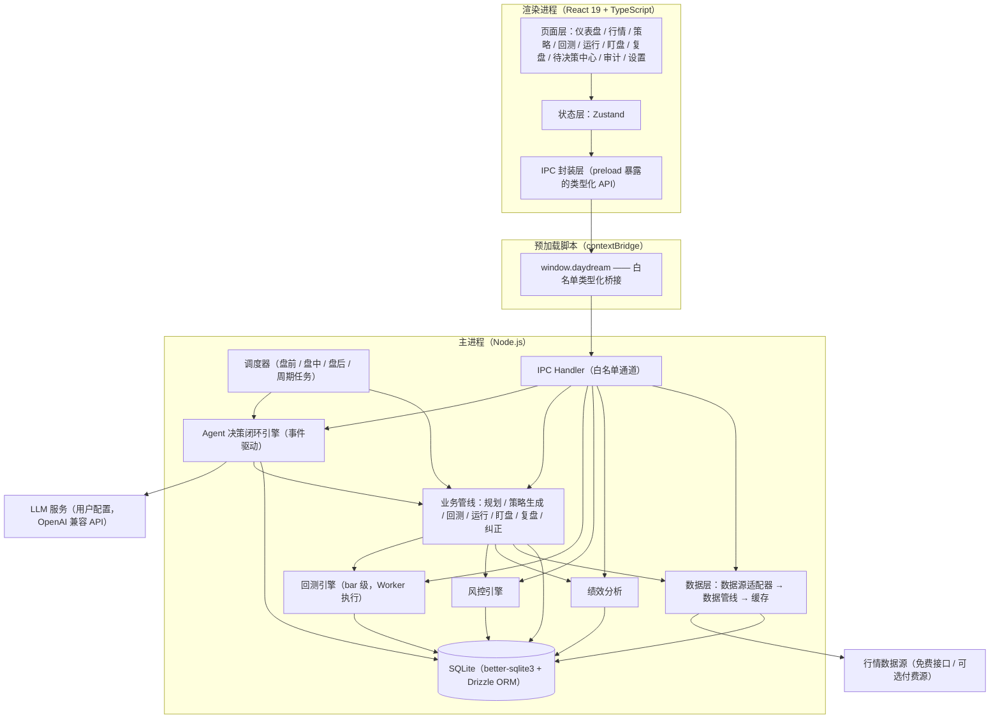

# Daydream 实现方案（总体设计）

> 本文档是 Daydream 项目的总体实现方案，覆盖目标对齐、总体架构、技术选型、进程模型、工程结构、开发计划、质量保障与风险应对。
> 配套文档：
> - [实现方案-Agent决策闭环设计.md](./实现方案-Agent决策闭环设计.md)——AI 决策闭环的核心机制设计
> - [实现方案-数据模型与模块设计.md](./实现方案-数据模型与模块设计.md)——数据库、回测引擎、风控、绩效与界面设计
> - [系统规则与账户模型.md](./系统规则与账户模型.md)——账户模型、数据共享与隔离规则、模型配置规则与 Agent 能力清单

---

## 1. 项目定位与目标回顾

Daydream 是一款面向 A 股市场的 AI 量化决策辅助桌面应用，核心链路为：

**自动规划 → 自动生成策略 → 自动回测 → 自动运行 → 自动盯盘 → 自动复盘 → 自动纠正**

AI 自主完成策略构思、验证、决策与迭代的完整闭环，产出**交易建议**；交易由人工执行，人工同时负责监督与兜底。

三个核心目标：

| 目标 | 落点 |
| --- | --- |
| 决策闭环自动化 | 从规划到纠正各环节自动衔接，无需人工参与即可持续运转 |
| 自我进化 | 通过复盘与纠正机制，策略随市场变化持续迭代优化 |
| 稳定可靠 | 运行链路稳定；运行状态、决策依据与交易建议全程可观察、可追溯 |

## 2. 设计原则

1. **AI 决策、人工执行**：系统只产出交易建议与预警，不接入券商交易通道；所有涉及资金的动作均由人工完成。
2. **少占用人的注意力**（对齐 dsh-superagent 理念）：Agent 自主推进工作，仅在需要人决策或产出可用结果时汇报；其余内容只记录、不打扰。
3. **决策可追溯**：每次 LLM 决策的输入上下文、输出结论、依据数据均落库快照，可随时回溯。
4. **本地优先、安全优先**：数据、策略、密钥全部本地存储，策略与数据不出本机；渲染进程不接触任何敏感能力。
5. **声明式策略、沙箱执行**：AI 生成的策略为受 Schema 约束的声明式 DSL，由确定性执行引擎解释执行，禁止任意代码执行。
6. **多源适配、渐进可靠**：行情数据源采用适配器模式，免费源为主、付费源可选，单源失效自动降级。
7. **可配置、可接管**：模型、数据源、风控阈值、Agent 自主级别均由用户配置；任一环节支持人工介入。

## 3. 总体架构

### 3.1 架构分层



### 3.2 架构要点

- **主进程承载全部业务逻辑**：Agent 闭环、数据获取、回测任务调度、风控、绩效、SQLite 均运行于主进程（Node 环境），回测计算与数据解析在 Worker 中执行。渲染进程只负责展示与交互，二者通过白名单 IPC 通信。
- **Agent 为调度中枢**：Agent 决策闭环引擎是系统大脑，七环节业务管线作为它的"工具"与"执行器"被调用，而非各自独立运行。
- **数据库单一入口**：SQLite 由主进程独占访问（better-sqlite3 同步 API），渲染进程一切读写均经 IPC。
- **事件驱动闭环**：参考 dsh-superagent 的「触发 → 评估 → 决策 → 工作项 → 执行 → 汇报」闭环（详见配套文档《实现方案-Agent决策闭环设计.md》）。
- **CPU 密集任务隔离**：回测计算与全市场数据解析运行于 Worker Threads / utilityProcess（工作进程），主进程只负责任务调度与 Agent 循环，保证 UI 交互与 IPC 始终流畅。

### 3.3 主链路与模块映射

| 主流程环节 | 实现模块 | 触发方式 |
| --- | --- | --- |
| 自动规划 | Planner 管线 + 规划工作项 | 定时（每日盘前）+ 纠正完成后触发新一轮 |
| 自动生成策略 | Strategist 管线 + 策略 DSL Schema | 规划产出后自动执行 |
| 自动回测 | Backtester 管线 + 回测引擎 | 策略生成/修改后自动执行 |
| 自动运行 | Runner 管线 + 信号引擎 | 回测达标且人工批准后 |
| 自动盯盘 | Monitor 管线 + 预警器 | 盘中定时轮询 |
| 自动复盘 | Reviewer 管线 | 定时（每日盘后 / 每周） |
| 自动纠正 | Corrector 管线 | 复盘产出结论后自动执行 |

## 4. 技术选型

### 4.1 选型总表

| 领域 | 选型 | 说明 |
| --- | --- | --- |
| 桌面框架 | Electron（最新稳定版） | 双平台（macOS / Windows）原生支持，生态成熟 |
| 前端框架 | React 19 | 需求指定 |
| 语言 | TypeScript（strict 模式） | 全链路类型安全 |
| 构建工具 | electron-vite | Vite 驱动，主/预加载/渲染三端统一构建，渲染端支持 HMR |
| UI 组件库 | **Ant Design 5**（推荐） | 详见 4.2 论证 |
| 图表 | lightweight-charts（K 线）+ ECharts（统计图表） | TradingView 官方 K 线库，性能好、交互专业 |
| 状态管理 | Zustand | 轻量、无样板代码 |
| 本地存储 | SQLite + better-sqlite3 + Drizzle ORM | 详见 4.4 论证 |
| Agent 框架 | 自研轻量事件驱动闭环（TypeScript），参考 dsh-superagent 架构 | 详见 4.3 论证 |
| 模型接入 | Vercel AI SDK（`@ai-sdk/openai-compatible`） | 模型无关，用户配置 baseURL / apiKey / model |
| 任务调度 | 自研调度器（基于 cron 表达式 + 事件总线） | 盘前/盘中/盘后节律与策略运行周期 |
| 日志 | electron-log | 主进程分级日志，落盘滚动 |
| 单元测试 | Vitest | 与 Vite 同构 |
| 打包发布 | electron-builder | 双平台安装包、签名与公证 |
| 加密 | Node.js `crypto`（AES-256-GCM） | 密钥、敏感配置加密存储 |

### 4.2 UI 组件库选型论证

| 候选 | 优势 | 劣势 | 结论 |
| --- | --- | --- | --- |
| **Ant Design 5** | 组件最全（表格、表单、日期、通知等密集业务组件）、中文文档一流、量化类桌面应用先例多 | 体积较大、定制化偏重 token 体系 | **推荐** |
| Arco Design | 轻量现代，表格虚拟滚动好 | 社区规模与长期维护弱于 AntD | 备选 |
| shadcn/ui | 高度可定制、体积可控 | 无开箱即用的复杂表格/通知中心，数据密集型应用开发成本高 | 不选 |

本应用是典型的数据密集型工具（大量表格、指标面板、表单配置），Ant Design 5 的开发效率最高；其 token 体系可定制为深色主题，契合交易终端观感。

兼容性说明：React 19 与 Ant Design 5 需安装官方补丁 `@ant-design/v5-patch-for-react-19`；若开发启动时 Ant Design 6 已发布稳定版（原生支持 React 19），优先采用 v6。

### 4.3 Agent 框架选型论证

需求明确参考 dsh-superagent 的架构（事件驱动「触发 → 评估 → 决策 → 工作项 → 执行 → 汇报」闭环）。对主流方案的评估：

| 候选 | 问题 |
| --- | --- |
| LangGraph（Python） | Python 生态，与 Electron/TypeScript 集成需跨进程桥接，运维复杂；图状态机对"持续运转的桌面 Agent"偏重 |
| LangGraph.js / Mastra | 通用 Agent 框架，抽象与本项目的"定时触发 + 工作项 + 汇报"模型不直接匹配，学习与改造代价高 |
| dsh-superagent 原项目 | Python 实现且面向 GitHub 场景，不可直接复用；但其**架构理念**（事件驱动、工作项、汇报分级）与本需求高度契合 |
| **自研轻量闭环（推荐）** | TypeScript 实现，与主进程同构；代码量可控（约 3~5k 行）；完全贴合需求架构描述；模型接入通过 AI SDK 解耦 |

**结论**：采用「自研 TypeScript 事件驱动闭环引擎 + Vercel AI SDK 模型接入层」组合。自研部分是**编排层**（事件循环、工作项状态机、会话管理、汇报通道），模型能力全部经由 AI SDK 的标准接口，未来若需替换编排层为成熟框架，业务管线与工具集可平滑迁移。

### 4.4 数据存储选型论证

| 候选 | 结论 |
| --- | --- |
| better-sqlite3 + Drizzle ORM | **推荐**：同步 API（主进程内无并发竞争问题）、性能最佳；Drizzle 提供类型安全的 Schema 与迁移，且可下探原生 SQL。注意大事务需分批提交，避免阻塞主进程事件循环 |
| node:sqlite（内置） | 能力尚不完整（无 ORM 生态、迁移弱），不选 |
| sql.js（WASM） | 性能与持久化不如原生，不选 |
| 其他（LevelDB 等） | 缺少关系查询能力，不选 |

注意：better-sqlite3 为原生模块，需在 Electron 环境中 rebuild（electron-rebuild），CI 中对 macOS 与 Windows 双平台构建验证。

### 4.5 模型接入方案

- 用户配置：API 地址（OpenAI 兼容）、API Key、模型名、上下文长度、调用频率上限。
- 接入层：`@ai-sdk/openai-compatible`，兼容 DeepSeek、通义千问、Moonshot、OpenAI 等主流服务。
- 结构化输出：策略 DSL、行动计划、复盘结论等关键输出统一要求 JSON 结构化输出（AI SDK `generateObject` + Zod Schema 校验），校验失败自动重试，仍失败则工作项标记为 `failed` 并汇报。
- 成本控制：按工作项类型设定最大 token 预算；模型调用全部记入审计日志（不记录 API Key）。

### 4.6 行情数据源方案

无初始数据，由 AI 通过工具自行获取正规可靠数据。方案采用**数据源适配器**模式：

| 优先级 | 数据源 | 能力 | 限制 |
| --- | --- | --- | --- |
| 首选 | 东方财富公开行情接口 | 实时行情、日/分钟 K 线、股票列表 | 免费接口，需限频（每源 ≤ 2~3 次/秒）、仅限个人研究使用 |
| 次选 | 腾讯行情公开接口 | 实时行情、分时、日 K | 同上 |
| 可选付费 | Tushare Pro / 专业数据服务 | 财务数据、指数成分、因子数据 | 需用户提供 token，按积分计费 |

适配器统一抽象 `MarketDataProvider` 接口（股票列表、实时快照、历史 K 线、复权因子），实现源故障自动降级（首选超时切换次选）、限频队列、数据完整性校验。复权处理：存储不复权原始数据 + 复权因子，回测时按需计算前复权/后复权。

合规提示：免费接口仅供个人学习研究，界面与文档中明示数据来源与免责声明。

### 4.7 数据获取策略

- 初始建库：安装后由数据管线拉取全市场股票列表与近 N 年日线（N 默认 3，可配置），后台渐进式下载并展示进度。
- 增量更新：每交易日收盘后自动更新当日日线；盘中按周期刷新自选池与持仓相关标的的实时行情。
- AI 取数：Agent 通过数据工具按需查询，缺数据时触发补数任务，形成"取数 → 入库 → 供分析"的闭环。

## 5. 进程模型与 IPC 设计

### 5.1 进程划分

| 进程 | 职责 | 权限 |
| --- | --- | --- |
| 主进程（main） | Agent 闭环、业务管线、风控/绩效、数据层、SQLite、调度、IPC、回测任务调度 | Node 全能力；唯一持有 DB 连接与密钥 |
| 工作进程（worker） | 回测计算、全市场数据下载与解析（Worker Threads / utilityProcess） | 无 DB 直连，结果经消息回传主进程落库 |
| 渲染进程（renderer） | React UI | `contextIsolation: true`、`sandbox: true`、`nodeIntegration: false` |
| 预加载（preload） | `contextBridge.exposeInMainWorld('daydream', api)` | 仅暴露白名单类型化 API |

### 5.2 IPC 通道规范

- 命名：`域:动作`，例如 `agent:getWorkItems`、`backtest:start`、`data:getKline`、`signal:list`、`settings:update`。
- 事件推送：主进程 → 渲染进程统一走 `daydream:event` 通道，事件载荷含 `type`（如 `signal.new`、`agent.report`、`data.progress`）与 `payload`。
- 类型安全：`src/shared/ipc.ts` 集中声明通道名与请求/响应类型，主进程 handler 与 preload API 均引用同一类型定义。
- 所有 IPC 请求带 requestId，支持取消与超时（默认 30s，回测等长任务返回任务句柄异步轮询）。

## 6. 工程结构

```
daydream/
├── package.json
├── electron.vite.config.ts
├── tsconfig.json / tsconfig.node.json / tsconfig.web.json
├── electron-builder.yml
├── drizzle.config.ts
├── src/
│   ├── main/                      # 主进程
│   │   ├── index.ts               # 入口：窗口、生命周期、模块装配
│   │   ├── agent/                 # Agent 决策闭环引擎（详见配套文档）
│   │   │   ├── loop/              # 事件循环：trigger / evaluate / decide / report
│   │   │   ├── workitem/          # 工作项模型与状态机
│   │   │   ├── session/           # Agent 会话（消息历史、上下文组装）
│   │   │   ├── tools/             # 工具集（LLM 可调用）
│   │   │   └── prompts/           # 提示词模板（版本化）
│   │   ├── pipeline/              # 七环节业务管线
│   │   │   ├── planner.ts
│   │   │   ├── strategist.ts
│   │   │   ├── backtester.ts
│   │   │   ├── runner.ts
│   │   │   ├── monitor.ts
│   │   │   ├── reviewer.ts
│   │   │   └── corrector.ts
│   │   ├── backtest/              # 回测引擎（纯函数，可独立测试）
│   │   ├── risk/                  # 风控规则引擎
│   │   ├── perf/                  # 绩效计算与归因
│   │   ├── data/                  # 数据层
│   │   │   ├── providers/         # 数据源适配器
│   │   │   ├── pipeline/          # 数据管线（拉取/清洗/入库）
│   │   │   └── service/           # 数据服务（对上层统一出口）
│   │   ├── db/                    # SQLite：连接、Schema、迁移、仓储
│   │   ├── scheduler/             # 调度器
│   │   ├── ipc/                   # IPC Handler 注册
│   │   └── services/              # 日志、加密、审计等横向服务
│   ├── preload/
│   │   └── index.ts               # contextBridge 白名单 API
│   ├── renderer/
│   │   ├── index.html
│   │   └── src/
│   │       ├── pages/             # 页面（见配套文档·界面设计）
│   │       ├── components/        # 通用组件
│   │       ├── stores/            # Zustand
│   │       ├── api/               # 对 preload API 的封装
│   │       └── styles/
│   └── shared/                    # 三端共享
│       ├── types/                 # 领域模型类型
│       ├── ipc.ts                 # IPC 通道与类型声明
│       ├── strategy/              # 策略 DSL Schema（Zod）
│       └── constants/             # 交易时间、涨跌停规则等常量
├── resources/                     # 图标、资源
├── tests/                         # Vitest（回测引擎、风控、DSL 校验重点覆盖）
└── docs/                          # 项目文档
```

## 7. 开发计划与里程碑

总计约 21 周，按依赖关系排序，每阶段产出可运行、可验收的增量。

| 阶段 | 内容 | 周期 | 验收要点 |
| --- | --- | --- | --- |
| M0 工程初始化 | electron-vite 脚手架、目录规范、SQLite 接入（better-sqlite3 rebuild）、IPC 骨架、日志与审计框架、CI（双平台构建） | 1 周 | 双平台可启动；DB 迁移可执行；IPC 示例链路通 |
| M1 数据层 | 数据源适配器（东财/腾讯）、股票列表与日线拉取入库、增量更新调度、限频与降级 | 2 周 | 全市场日线入库；单源故障自动降级、全源不可用挂起并告警；补数任务 |
| M2 Agent 内核 | 事件循环、工作项状态机、会话与上下文组装、模型接入（AI SDK）、工具集框架、汇报通道 | 3 周 | 定时事件可驱动完整闭环；结构化输出校验与重试 |
| M3 规划与策略生成 | Planner/Strategist 管线、策略 DSL Schema 与校验器、指标库基础 | 2 周 | 给定市场数据，可自动产出合法策略 DSL |
| M4 回测引擎 | bar 级回测引擎（A 股规则：T+1、涨跌停、费用）、绩效指标、回测报告 | 3 周 | 回测结果与手工核算样例一致；指标计算正确 |
| M5 运行与盯盘 | Runner 管线、信号引擎、风控基础规则（信号前置校验）、Monitor 管线、预警、盘中调度 | 3 周 | 运行中策略定时产出信号且附风控结论；盯盘触发预警 |
| M6 复盘与纠正 | Reviewer/Corrector 管线、复盘报告、纠正动作执行 | 2 周 | 日/周复盘自动产出；纠正建议可执行并闭环 |
| M7 平台能力 | 多账户工作区、风控规则管理面板与高级规则、绩效分析与可视化、策略加密与安全加固 | 3 周 | 四类平台能力全部可用且互不影响 |
| M8 打磨与发布 | 界面完善、性能优化、异常恢复、打包签名（macOS 公证 / Windows 签名）、文档 | 2 周 | 安装包在双平台安装运行；升级与数据迁移验证 |

依赖关系：M1 → M2 → M3 → M4 → M5 → M6 → M7，M0 贯穿始终。

## 8. 质量保障

### 8.1 测试策略

| 层级 | 范围 | 工具 |
| --- | --- | --- |
| 单元测试 | 回测引擎（撮合、T+1、费用、指标）、风控规则、DSL Schema 校验、数据清洗、复权计算——以上为确定性逻辑，测试覆盖 > 80% | Vitest |
| 集成测试 | 数据适配器（mock 数据源）、DB 仓储、IPC handler、工作项状态机 | Vitest |
| 冒烟测试 | LLM 相关链路以录制回放（golden sample）方式验证结构化输出解析 | Vitest |
| 端到端 | 核心用户旅程（配置模型 → 自动出策略 → 回测 → 批准运行 → 收到信号） | Playwright（M8 补强） |

### 8.2 可观测性

需求要求"运行状态、决策依据与交易建议全程可观察、可追溯"，落地为：

- **运行状态**：所有工作项、管线任务、数据任务的状态与进度实时推送到界面；心跳监控主循环健康。
- **决策依据（审计）**：`audit_log` 表记录每次 LLM 调用的输入摘要、输出、token 消耗；`decision_record` 表快照每个关键决策（规划、策略生成、纠正）的上下文与结论。
- **交易建议**：每条信号记录产生时点的数据快照（行情、持仓、风控结果、生成依据），信号状态（待执行/已执行/已忽略/过期）由人工反馈闭环。
- **日志**：electron-log 分级落盘（错误/警告/信息/调试），支持导出日志包用于问题排查。

## 9. 安全与合规

| 维度 | 措施 |
| --- | --- |
| 渲染进程隔离 | `contextIsolation: true`、`sandbox: true`、`nodeIntegration: false`、CSP 限制、仅白名单 preload API |
| 密钥保护 | API Key 等敏感配置以 AES-256-GCM 加密后入库，密钥材料经 Electron `safeStorage`（macOS Keychain / Windows DPAPI）保护，日志与审计永不记录明文 |
| 策略安全 | 策略与数据仅本地存储；数据目录 0700、库文件 0600 权限保护；可选整库加密（SQLCipher，M7 评估）；策略导出/导入加密 |
| 策略执行安全 | 策略为声明式 DSL，仅由确定性引擎解释，无任意代码执行面 |
| 合规 | 免费行情仅限个人研究使用，界面明示数据来源与免责声明；本系统不提供投资建议承诺，输出均为决策辅助 |
| 依赖安全 | 依赖锁定（pnpm lockfile）、常规安全审计（`pnpm audit`）；原生模块（better-sqlite3）版本与 Electron ABI 严格对齐 |

## 10. 风险与应对

| 风险 | 影响 | 应对 |
| --- | --- | --- |
| 免费行情源限频、变更或失效 | 数据中断，闭环停摆 | 多源适配与自动降级；增量缓存；可选付费源接入；数据状态在界面可见 |
| LLM 输出不稳定（非法 DSL、幻觉指标） | 策略无法回测或失真 | Zod Schema 强校验 + 自动重试；指标库白名单；失败即失败（不静默降级）并汇报 |
| 回测过拟合，实盘建议失真 | 策略自我进化失效 | 样本内/样本外分段回测；最小交易次数、参数复杂度惩罚；纠正环节专项识别 |
| LLM 调用成本失控 | 运行成本高 | 按工作项 token 预算、调用频率上限、降级模型配置 |
| SQLite 数据量增长性能下降 | 查询变慢 | WAL 模式、合理索引、行情表按年分表（统一视图）、定期 VACUUM |
| 原生模块跨平台打包失败 | 安装包不可用 | CI 双平台构建验证；better-sqlite3 预编译二进制与 electron-rebuild 双保险 |
| Agent 自主行为偏离预期 | 产出错误建议 | 自主级别分级可配；关键动作（策略上线、纠正淘汰）默认需人工批准；审计可回溯 |
| 机器时区/节假日调休导致节律错乱 | 盘中错过盯盘、盘后误判 | 全部交易节律以 Asia/Shanghai 计算（与机器时区无关）；内置交易日历含调休校正，缺失时由指数数据推断 |

## 11. 验收标准（总体）

1. 闭环自动化：安装配置模型与数据源后，系统可自动完成一轮「规划 → 生成 → 回测」，无需人工干预。
2. 建议可执行：运行中策略按调度稳定产出信号，信号含依据、风控结论与可执行说明，人工可据此下单。
3. 自我进化：经历若干轮复盘后，系统能自动修正或淘汰表现不佳的策略，且全程有审计记录。
4. 平台能力：多账户切换、风控拦截、绩效可视化、策略本地加密均可用。
5. 双平台：macOS 与 Windows 安装包可安装、可运行、可自动升级数据与迁移库结构。
6. 可靠性：连续运行 30 天无主循环崩溃；数据源单源失效不影响已有数据查询与历史回测。
